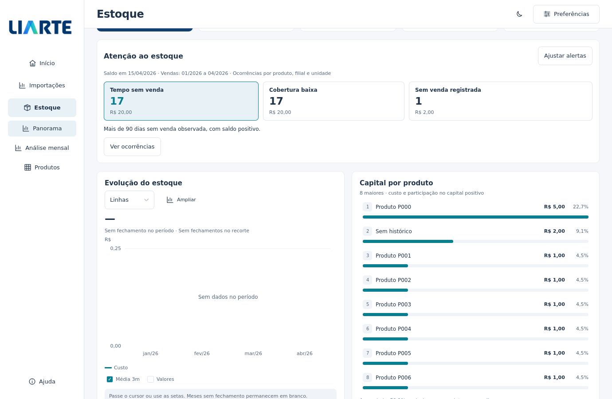

# Alertas de estoque

Esta melhoria está nos fontes em desenvolvimento. Os pacotes publicados anteriormente não recebem a alteração automaticamente.

No módulo **Estoque**, o painel **Atenção ao estoque** resume situações para investigar na base carregada. Selecione uma categoria para abrir suas ocorrências; **Ver posições** aplica produto, filial e unidade juntos à tabela. Os demais filtros do recorte são preservados.



[Configuração em janela compacta e tema escuro](images/alertas-configuracao.png). As capturas usam dados sintéticos e renderização Qt em Linux; a aparência nativa no Windows também depende da fonte e da escala do monitor.

## Regras e referências

| Categoria | Regra inicial | Referência |
| --- | --- | --- |
| Tempo sem venda | Saldo selecionado positivo e última venda positiva observada há **mais de 90 dias** | Data da base, mesmo que o período de vendas selecionado seja anterior |
| Cobertura baixa | Cobertura conhecida da filial **inferior a 30 dias**, incluindo zero quando calculável | Saldo atual de todas as posições da filial e demanda líquida no período selecionado |
| Sem venda registrada | Saldo selecionado positivo sem saída positiva observada | Categoria informativa: o prazo sem venda é desconhecido |

Os limites são estritos: exatamente 90 dias não entra em “mais de 90”; exatamente 30 dias não entra em “inferior a 30”. Em **Ajustar alertas**, os dois valores podem ser alterados para inteiros entre 1 e 3650. **Restaurar padrões** preenche o formulário; somente **Aplicar limites** confirma. Cancelar ou fechar o diálogo descarta o rascunho.

Uma ocorrência representa um produto, filial e unidade. Vários armazéns dessa combinação não multiplicam a contagem. As quantidades das posições selecionadas são agrupadas somente na mesma unidade; o capital exibido é a parte positiva do custo após essa agregação. Um grupo pode aparecer em duas regras, portanto não se devem somar contagens ou capital entre categorias.

A cobertura fica indisponível com filtro de armazém: as vendas não têm essa atribuição. Valores desconhecidos, saldos negativos ou ausência de demanda líquida positiva não viram cobertura zero. Quando nenhum grupo tem cobertura calculável, o painel mostra avaliação indisponível. Saldo zero com demanda positiva pode gerar cobertura conhecida de zero dias.

O painel considera as posições atuais que passaram pelos filtros. Não inventa posições para produtos presentes apenas no histórico. Tempo sem venda não mede idade de lote, obsolescência ou consumo interno; cobertura não garante uma data de ruptura. A ausência de venda registrada não comprova que o limite de dias foi ultrapassado.

O cartão anterior **Sem venda >90 dias** mantém sua definição histórica, que inclui capital sem venda registrada. A nova categoria de tempo sem venda contém somente prazos conhecidos; a categoria informativa mostra os demais grupos separadamente.

## Persistência, atualização e exportação

Os limites ficam nas preferências do perfil ativo. No perfil de desenvolvimento, são independentes dos limites da instalação em uso. Sem preferências persistentes, ou quando a gravação falha, a interface informa que o ajuste vale apenas para a sessão.

A mudança dos limites reutiliza a análise carregada em uma tarefa cancelável. Não relê o PBIX, não consulta a rede e mantém página, produto detalhado e mês em investigação. Somente uma atualização concluída publica e salva os novos limites. Cancelar a atualização restaura a configuração aplicada anteriormente; resultados antigos não são apresentados como se usassem a nova regra.

A interface mostra até oito ocorrências da categoria aberta. A exportação habitual de Estoque acrescenta a aba **Alertas**, com todas as ocorrências, limiares, saldo, capital, última venda, cobertura, data e período. A aba **Leitura dos indicadores** registra regras e limitações. Campos desconhecidos ficam vazios; zeros conhecidos continuam numéricos. Listas que ultrapassem o limite de uma aba são divididas em abas numeradas.

## Verificação

Os testes registrados em `verificar.py` cobrem limites, ausência de histórico, agrupamento por unidade e filial, cobertura indisponível, exportação completa, persistência, cancelamento e publicação concorrente. Os testes Qt também exercitam o diálogo, a investigação na tabela, navegação por teclado e janela compacta. Para executá-los com o restante da suíte:

```sh
python verificar.py --headless --volume
```
