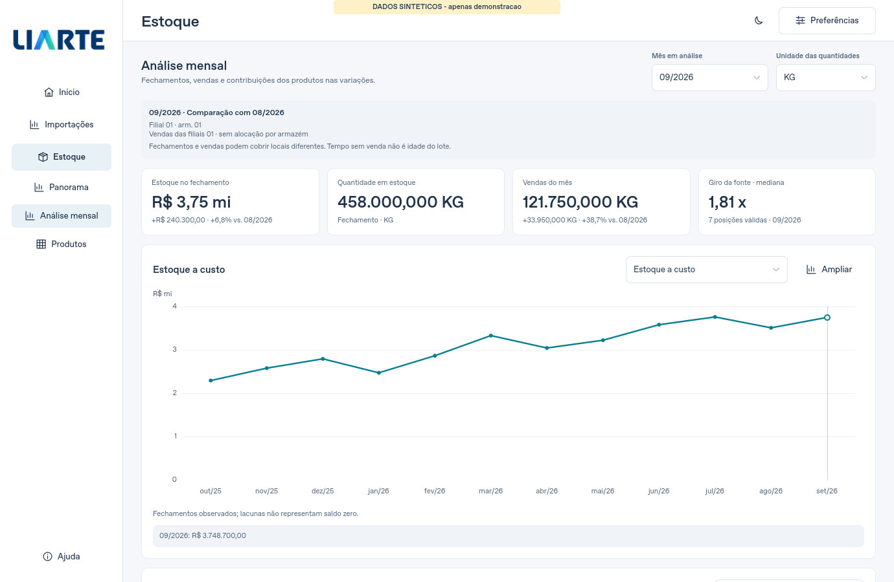
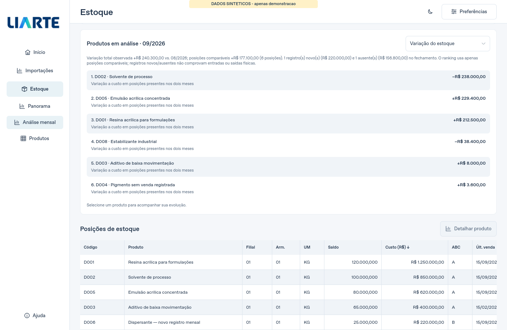
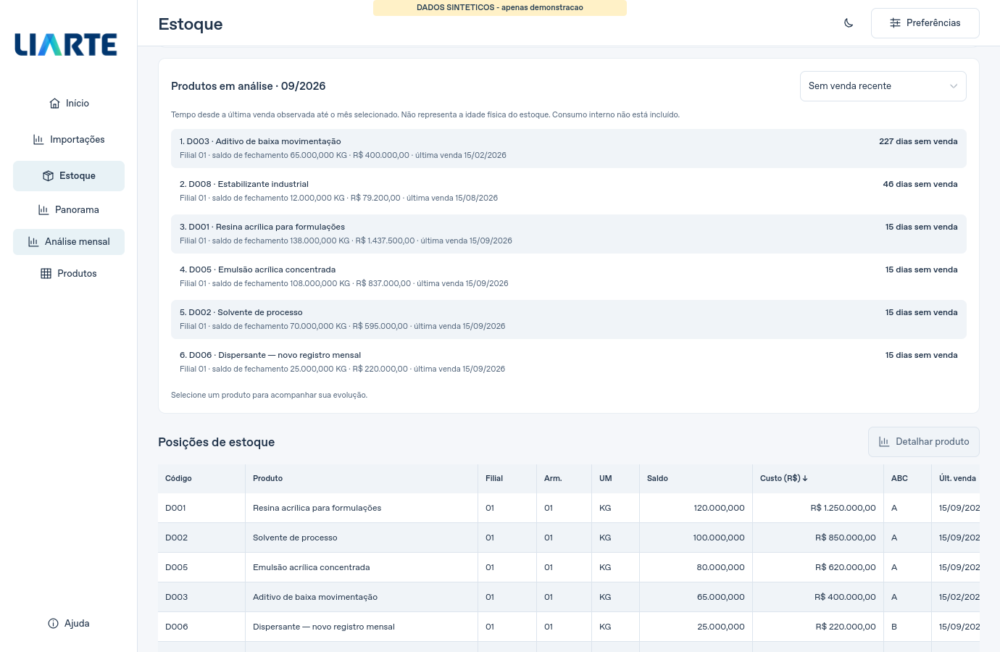
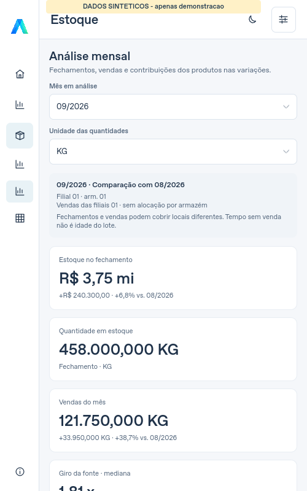
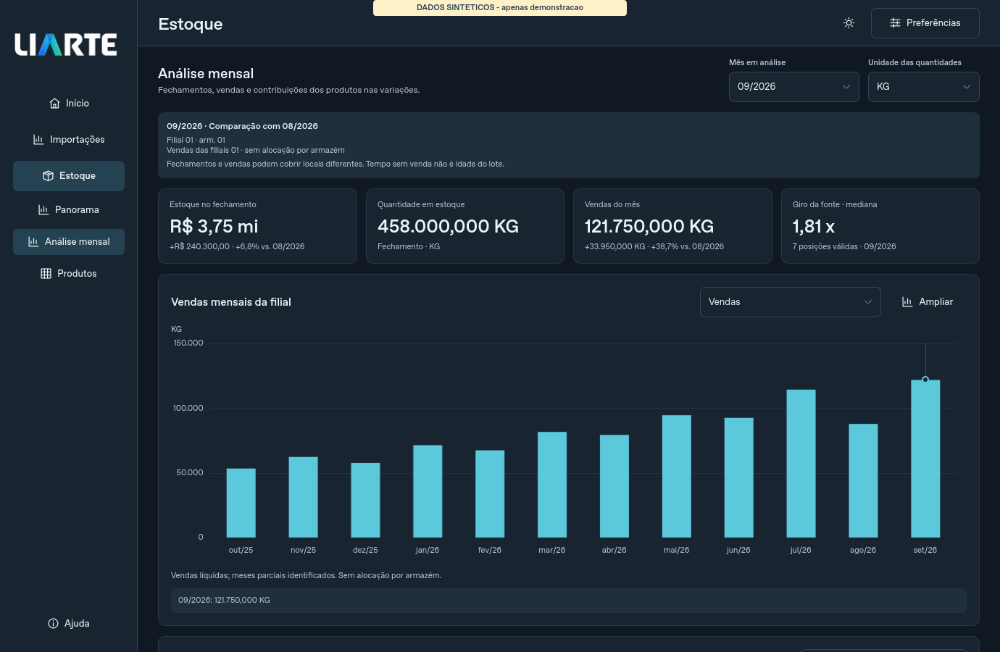

# Estoque e vendas por mês — prévia 5.3.0-rc.2

A seção **Análise mensal** separa os fechamentos históricos do panorama de
saldo atual. Seu objetivo é localizar produtos com maior saída, acompanhar
o giro informado pela fonte e investigar quais produtos contribuíram para
as variações mensais. Os dados são processados localmente, sem novas consultas
ao Comex Stat ou conexão ao ERP.

## Decisões antes da implementação

A auditoria da base integrada identificou fechamentos de janeiro de 2019 a
setembro de 2026 somente na filial 01/armazém 01. As vendas incluem três
filiais e chegam a 21 de outubro de 2026; o saldo atual cobre duas filiais.
Por isso, a abrangência do fechamento e das vendas aparece separadamente.
Outubro é um mês parcial de vendas e não tem fechamento nessa base.

Há produtos históricos e vendidos que já não possuem posição no saldo atual.
Partir apenas da tabela atual excluiria esses produtos, inclusive itens já
esgotados. A análise mensal usa as próprias fontes históricas. As opções de
filial, armazém e unidade passaram a considerar a união das fontes.

O arquivo contém quantidades de vendas e custo, sem faturamento, entradas por
lote ou todos os movimentos de estoque. A interface distingue contribuição
observada de causa: compras, transferências, ajustes e consumo interno não
podem ser confirmados a partir desses dados. Tempo desde a última venda e
`DiasEstoqueQtd` não representam a idade física dos lotes.

## Fluxo de leitura

1. Use **Mês inicial/final** para definir a janela e **Análise mensal** na
   navegação de Estoque. O mês em análise inicia no último fechamento
   disponível dentro da janela; também é possível selecionar meses sem
   fechamento para consultar suas vendas.
2. Escolha o mês e a unidade das quantidades. Os cartões apresentam estoque
   a custo, quantidade no fechamento, vendas líquidas e giro mediano da fonte.
   A unidade selecionada afeta as quantidades; valores monetários e giro
   continuam considerando o recorte dos filtros gerais.
3. Troque a medida do gráfico entre custo, quantidade, vendas e giro.
   **Ampliar** usa os mesmos pontos. O cursor e as setas consultam valores;
   a seleção explícita do mês controla os cartões e listas.
4. Consulte **Mais vendidos**, **Sem venda recente**, **Sem venda registrada**,
   **Menor giro da fonte**, **Variação do estoque** e **Variação de vendas**.
   As listas mostram os primeiros produtos/posições e preservam os sinais das
   variações. Selecionar um produto acompanha sua evolução na mesma janela.
5. Use **Baixar Excel** para o detalhamento mensal completo, além dos destaques
   exibidos na tela. No detalhe de uma posição atual também há gráficos de
   quantidade e custo no fechamento, além de vendas e giro.

Os cabeçalhos, controles, cartões e linhas reorganizam-se em janelas menores;
contexto, nomes e valores longos podem quebrar linha. O panorama atual mantém
sua própria data e indicadores.

## Regras dos indicadores

| Medida | Regra e limite de interpretação |
|---|---|
| Estoque mensal | Soma do custo das posições observadas no fechamento. Não soma meses e não reconstrói saldo a partir de vendas. |
| Quantidade | Separada por unidade original. KG, L, UN e outras unidades não são somadas. |
| Vendas | Quantidade líquida por produto/filial/unidade, incluindo devoluções. Não é faturamento. Uma venda é contada uma vez, mesmo com vários armazéns. |
| Armazém | Vendas mensais ficam indisponíveis ao filtrar armazém, pois a fonte não identifica esse local nas vendas. A recência continua explicitamente sendo da filial. |
| Giro mediano | Mediana dos giros não negativos da fonte em posições com quantidade positiva no fechamento do mês. A tela informa a contagem de posições; não é giro consolidado. Valores originais negativos permanecem no Excel. |
| Sem venda recente | Dias desde a última saída positiva observada até o fim do mês, limitado à data da base, por produto/filial/unidade. Não mede permanência dos lotes nem consumo interno. |
| Sem venda registrada | Lista própria para ausência de saída positiva observada. Não atribui idade e não classifica automaticamente o produto como obsoleto. |
| Menor giro | Ordena os giros válidos da fonte por posição com saldo positivo; localização e unidade acompanham cada linha. |
| Variação do estoque | Compara meses imediatamente consecutivos com fechamento completo. A contribuição por produto usa posições idênticas nos dois meses. |
| Cobertura dos registros | Custo total observado: variação das posições pareadas + custo dos registros novos − custo dos registros ausentes. Novo/ausente não significa entrada/saída física ou saldo zero. |
| Variação de vendas | Compara dois meses completos consecutivos observados, por unidade. Inclui produtos com venda em apenas um dos meses e preserva devoluções. |
| Participação nas vendas | Percentual entre produtos com quantidade líquida positiva na mesma unidade. Produtos com devolução líquida não integram esse denominador. |

Meses sem fechamento ficam sem valor. Meses observados sem documento de venda
podem ter quantidade zero; meses fora da cobertura ficam sem valor. O início
da cobertura observada de vendas é a primeira data da fonte, mantendo a mesma
convenção do módulo existente. Meses parciais são identificados e não geram
comparação com meses completos.

ABC, atividade e sinal do saldo são filtros da situação **atual**. Quando
aplicados à análise mensal, selecionam explicitamente essa coorte atual de
posições/produtos, com aviso visível; não recalculam uma classificação histórica.

## Excel

As abas **Análise mensal**, **Variações mensais** e **Produtos mensais** incluem
todos os meses e registros do recorte, sem o limite dos rankings visuais.
Valores monetários aparecem uma vez por mês no resumo; quantidades ocupam
linhas por unidade. Lacunas permanecem em branco e os indicadores originais
da fonte são preservados no detalhe. Descrições são gravadas como texto,
sem interpretação como fórmulas.

As abas anteriores foram preservadas. **Vendas por filial** identifica que
usa produtos das posições atuais selecionadas, enquanto as novas abas usam
o universo histórico; esses totais podem diferir. As definições constam em
**Leitura dos indicadores**.

## Validação

Os testes cobrem produtos sem saldo atual, unidades diferentes, vendas
deduplicadas, devoluções, recência sem usar vendas futuras, giros negativos,
meses parciais, lacunas e mudanças de cobertura. A integração Qt verifica
troca de mês/unidade sem nova análise ou consulta, filtros históricos,
preservação do mês ao selecionar produto, redimensionamento e ampliação.

No Linux, a suíte completa passou com **657 testes em 139,091 s**. O ensaio
de 100 mil registros fez a primeira consulta em 1,631 s e processou 93
eventos Qt. Após os últimos ajustes de apresentação e do controle de retorno
a todos os produtos, os **31 testes específicos passaram em 2,832 s**.
As capturas integradas não registraram avisos QML.

Na base integrada, os 94 meses selecionados foram processados em 0,902 s.
As 92 comparações disponíveis de estoque e as 91 de vendas conciliam com
as contribuições por produto. A verificação usou a fonte local e não publicou
valores financeiros; meses parciais e sem fechamento permaneceram identificados.

Os quatro jobs Windows e a execução completa passaram no commit
`c700403678551ab3a7c65df24d9e0ec77d4d8582`. Cada job executou **657 testes**:
656 aprovados, um teste exclusivo de POSIX ignorado e nenhuma falha.
Os quatro executáveis 5.3.0-rc.2 passaram no autoteste nativo com Qt 6.10.3,
sem avisos QML e com os recursos de Excel, PDF e Power BI aprovados.

| Python do pacote | Aprovados | Ignorados | Tempo da suíte | Prévia Windows |
|---|---:|---:|---:|---|
| 3.11 | 656 | 1 | 236,624 s | [ZIP](https://github.com/Souzlx/Liarte_Interf/actions/runs/40010674136/artifacts/12526981355) |
| 3.12 | 656 | 1 | 252,839 s | [ZIP recomendado](https://github.com/Souzlx/Liarte_Interf/actions/runs/40010674136/artifacts/12526402134) |
| 3.13 | 656 | 1 | 233,825 s | [ZIP](https://github.com/Souzlx/Liarte_Interf/actions/runs/40010674136/artifacts/12527300058) |
| 3.14 | 656 | 1 | 288,311 s | [ZIP](https://github.com/Souzlx/Liarte_Interf/actions/runs/40010674136/artifacts/12526907022) |

Entre no GitHub para baixar. Feche a versão anterior, extraia o ZIP inteiro
em uma pasta nova e abra **LIARTE_Desktop.exe**. Confira **5.3.0-rc.2** em
Ajuda. O pacote inclui Python e dependências.

Os resultados nativos foram conferidos nos logs agrupados liberados após a
conclusão do workflow. O ZIP e seus hashes internos não foram reinspecionados
localmente. DPI/GPU específicos e a interpretação dos dados da empresa
continuam sujeitos à avaliação no computador de destino.
Metadados oficiais, digests e limites da conferência estão em
[VALIDACAO_WINDOWS_530_RC2.json](VALIDACAO_WINDOWS_530_RC2.json).

O job de publicação de release foi ignorado nesta prévia. A versão estável
5.2.0 permanece disponível; esta revisão é uma prévia para avaliação.
Evidências e hashes das imagens:
[EVIDENCIAS_ANALISE_MENSAL_530_RC2.json](EVIDENCIAS_ANALISE_MENSAL_530_RC2.json).

## Capturas com dados sintéticos

Estas imagens demonstram a apresentação. Todos os números e nomes são
sintéticos e não representam resultados reais da empresa.

Contribuições e mudanças de cobertura dos registros:

Tempo desde a última venda observada, sem interpretar como idade de lotes:

Janela compacta:

Tema escuro e vendas mensais:

