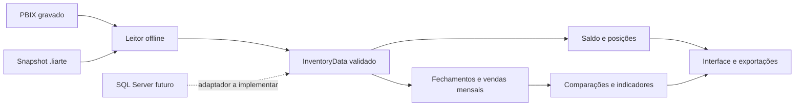

# Análises quantitativas e migração para SQL Server

Esta diretriz acompanha os fontes em desenvolvimento após a **5.3.1**. Os pacotes publicados dessa versão permanecem iguais. A origem futura foi informada pelo responsável pelo projeto como **Microsoft SQL Server**, o mesmo banco que alimenta os PBIX recebidos. A conexão direta ainda não está implementada nem foi validada contra o servidor da empresa.

## Apresentação dos resultados

A análise apresenta valores, diferenças absolutas, percentuais, séries e critérios quantitativos. Foram retiradas as hipóteses comerciais, sugestões de ações e verificações prontas do desempenho, dos recortes por produto e de suas exportações. Produtos, locais, unidades, referências e resultados vêm da base aceita; o código não fixa conclusões para produtos ou meses específicos.

Cada número conserva nome, unidade, período, denominador e disponibilidade. Definições permanecem acessíveis para distinguir custo de receita, cobertura de idade de lote e zero líquido de ausência de transações. Esses textos explicam os cálculos; não atribuem causas às variações.

| Recorte por produto | Condição observada |
| --- | --- |
| Critérios combinados | União sem duplicação dos três critérios seguintes |
| Cobertura < limite | Cobertura elegível, conhecida e inferior ao limite aplicado |
| Variação de vendas < 0 | Diferença negativa entre janelas comparáveis, base positiva, quantidade recente não negativa e saldo positivo no fechamento |
| Saldo > 0 · vendas líquidas = 0 | Saldo positivo e quantidade líquida recente conhecida igual a zero |
| Estoque a custo | Saldo e custo positivos no fechamento, ordenados por valor |

O limite de cobertura é uma **política configurável**, reutilizada de Ajustar alertas. Seu padrão inicial de 30 dias não foi aprendido dos dados e não determina uma compra. As janelas de 1, 3 e 6 meses são escolhas analíticas explícitas; a referência, a completude e os valores de cada janela são calculados a partir dos dados. Falta de histórico não deve ser preenchida com valores inventados.

## Um contrato para as fontes

`InventoryData` é o contrato normalizado existente: cadastro de produtos, saldos, fechamentos, vendas agregadas por dia, dimensões de local e referência da fonte. Os leitores de arquivos e uma futura origem SQL devem usar a mesma validação antes de entregar dados aos cálculos. A apresentação não deve conhecer consultas SQL ou tabelas do ERP.

A fábrica `inventory_from_records()` em `liarte_core.inventory_source` é usada pelos leitores atuais e recebe coleções tipadas já normalizadas. Ela congela as coleções, aplica a validação comum e preserva o `source_hash` de arquivos existentes. Quando esse hash é omitido, calcula SHA-256 do conteúdo normalizado, incluindo referência comercial e campos dos registros, sem usar o nome da fonte ou o próprio hash. Não muda o formato `.liarte` nem implementa consultas ou sincronização SQL.

Quantidades usam inteiros em milionésimos da unidade original; custos usam centavos inteiros. Giros e dias continuam indicadores da fonte, com elegibilidade própria. O futuro adaptador deve converter os tipos decimais sem passar quantidades ou custos por `float` e sem alterar o significado de valores negativos ou ausentes.

### Mapeamento a reconciliar

Os nomes abaixo são **objetos do modelo PBIX**, não nomes confirmados de tabelas do SQL Server. O [estudo do BI](ANALISE_BI_E_EXPERIENCIA.md) registra o grão, campos e limites examinados.

| Contrato normalizado | Modelo PBIX atual | Conferência necessária para SQL |
| --- | --- | --- |
| `Product` | `Dim_Produtos` | Código, descrição, grupo, tipo e unidade; tratamento de exclusões e de cadastros históricos ausentes |
| `Balance` | `Fato_EstoqueAtual` | Uma posição por produto, filial, armazém e unidade; quantidade e custo atuais |
| `Closing` | `Fact_Estoque` | Mesma chave de posição mais ano-mês; quantidade, custo, giro e dias originais |
| `Sale` | `Fato_DocumentoSaida` | Agregação diária por produto, filial e unidade; quantidade líquida, custo e existência de saída positiva preservados |
| Locais | `Dim_Filiais`, `Dim_Armazem` | Chaves e descrições, sem duplicar posições ou multiplicar fatos nas junções |
| Referência comercial | `Dim_Atualizacao` | Data da base, fuso e significado da atualização; não substituir pela data do computador |

O PBIX pode aplicar filtros, junções, conversões, marcadores `DELETED`, relacionamentos e medidas. A coincidência do banco de origem não garante equivalência de totais. Por exemplo, o estudo identificou uma página do BI que exclui posições bloqueadas, enquanto o contrato atual do aplicativo preserva todas as posições. A reconciliação exige o mesmo recorte e o mesmo significado, sem copiar automaticamente medidas inconsistentes do BI.

O campo `Sale.cost` continua sendo custo. Receitas, preços e margens exigem extensão própria e versionada do contrato. Vendas não possuem armazém no contrato atual; filtrar um armazém não autoriza atribuir suas vendas a esse local.

## Atualizações de uma base volátil

Uma atualização deve ler, normalizar e validar uma versão consistente, calcular em segundo plano e publicar o resultado aceito atomicamente. Cancelamentos e resultados de gerações anteriores não podem substituir uma versão mais recente. A última base válida permanece disponível quando uma atualização falha, identificada por sua referência.

A revisão do conteúdo deve considerar também alterações e exclusões antigas. Uma mudança retroativa pode afetar fechamentos comparados, vendas, última saída positiva, cobertura e classificações. Processar apenas novas linhas ou observar somente `MAX(data)` não atende a esse contrato.

Hashes identificam conteúdo ou arquivos, conforme sua origem. Não comprovam que várias consultas observaram o mesmo instante do SQL. Cache, recorte, janela, política e versão do algoritmo devem continuar associados à versão aceita. A identificação de conteúdo normalizado complementa essa preparação; não implementa sincronização ou detecção remota de alterações.

### Requisitos da conexão SQL futura

- Acesso somente leitura aos objetos autorizados; autenticação e segredos ficam em configuração segura, fora de código e logs.
- Estratégia de consistência compatível com as capacidades existentes. Isolamento transacional `SNAPSHOT` exige suporte habilitado. RCSI é consistente por instrução e, isoladamente, não garante que consultas sucessivas observem a mesma versão.
- Ausência de `NOLOCK` e `READ UNCOMMITTED` nos cálculos. O aplicativo não altera isolamento, dados, índices ou configurações administrativas automaticamente.
- Atualização completa consistente quando o volume permitir. Incremental exige protocolo confiável de inclusões, alterações e exclusões. Change Tracking ou CDC só podem ser usados quando disponíveis e autorizados; `rowversion` isolado não detecta exclusões.
- Frequência, tempo máximo, cancelamento, retenção e recuperação definidos com a empresa. Perda de um checkpoint incremental exige reconciliação ou nova leitura completa, sem omitir registros silenciosamente.

Faltam o esquema autorizado, as regras das transformações da origem, as chaves e tipos, o volume, as permissões de consistência/sincronização e a forma de acesso de rede. Não é necessário enviar senhas pelo chat para planejar esse contrato.

## Critérios de verificação

1. Mesmos dados normalizados produzem os mesmos números, independentemente do leitor.
2. Trocar datas e identificadores não exige editar o código analítico.
3. Correções e exclusões de vendas ou saldos alteram a revisão e os indicadores afetados.
4. Valores ausentes, zero, negativos e unidades diferentes continuam distintos.
5. Os indicadores conservam valores e precisão após a retirada das narrativas; interface e Excel não geram hipóteses ou recomendações.
6. Uma atualização obsoleta ou cancelada não substitui a mais recente; falhas preservam a última versão válida identificada.

Os testes locais usam dados sintéticos. Eles não substituem a reconciliação futura com consultas autorizadas ao SQL Server da empresa.
