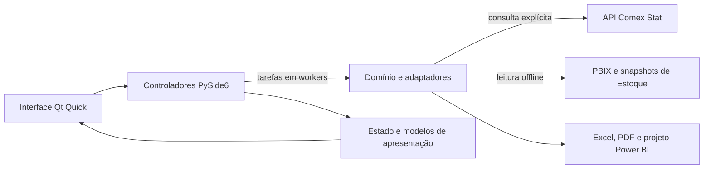

# Arquitetura

Referência da implementação consolidada na **5.3.1**. O LIARTE é um cliente desktop PySide6/Qt Quick. Importações consulta o Comex Stat; Estoque analisa arquivos locais. O cadastro de módulos descreve disponibilidade do produto, não permissões ou autenticação corporativa.



## Camadas e responsabilidades

| Caminho | Responsabilidade |
| --- | --- |
| `src/liarte_core/` | Contratos, validação, cálculos, consultas, IO e escopo das exportações, sem dependência da interface Qt. |
| `src/liarte_desktop/` | Composição da aplicação, controladores, workers, modelos Qt, perfis, identidade e integração com Windows. |
| `src/liarte_desktop/qml/` | Navegação, controles, diálogos, gráficos e componentes de apresentação. |
| `src/liarte_engine/` | Transporte, documentos e componentes de compatibilidade extraídos do motor original. |
| `tools/` | Preparação do ambiente, compilação, empacotamento e verificação da distribuição. |
| `tests/` | Testes de domínio, IO, exportações, interface, concorrência e distribuição. |

### Importações e mercado

- `comex.py` adapta os dados reais para os contratos de `domain.py`; `comex_api.py` implementa o cliente direto e as pausas da fonte.
- `query.py` filtra, agrega, ordena e pagina o snapshot aceito. Busca, ordenação e paginação não fazem uma nova consulta à API.
- `procurement.py` calcula referências de compra, médias ponderadas e comparações no mesmo recorte observado.
- `exports.py` captura o escopo aceito e delega a geração dos documentos ao motor.
- `controller.py`, `jobs.py` e `table_model.py` coordenam as tarefas e publicam apresentações limitadas para QML.

O fluxo normal do desktop usa a API diretamente, sem iniciar servidor HTTP local, central automática ou downloads CSV alternativos. Implementações anteriores de central e acesso automático permanecem para compatibilidade, ferramentas explícitas e regressões; não definem o modo padrão da aplicação atual.

As bases geral e municipal têm contratos separados. A geral identifica NCM e valores CIF; a municipal utiliza SH4 e FOB. Não se reconstrói NCM ou CIF a partir da base municipal. Valores monetários são tratados em unidades inteiras de centavo, preservando a precisão dos totais. Referências unitárias exigem peso válido e escopo comparável.

Uma consulta explícita obtém e valida os dados da API antes de publicar o novo snapshot. Metadados e pausas podem ser persistidos; respostas de consultas anteriores em disco não substituem a API no cliente direto. Tentativas e esperas são limitadas, cooperam com o cancelamento e respeitam HTTP 429. O transporte Windows preserva a verificação HTTPS pelo sistema operacional.

### Estoque e produtos

| Componente | Responsabilidade |
| --- | --- |
| `inventory.py` e `inventory_io.py` em `liarte_core` | Contratos tipados, análise do saldo e leitura/validação de PBIX ou `.liarte`. |
| `inventory_monthly.py` | Fechamentos e vendas mensais, com lacunas e unidades preservadas. |
| `inventory_alerts.py` | Regras de alerta, elegibilidade e agrupamento por produto, filial e unidade. |
| `inventory_compare.py` | Comparação entre dois meses e contribuições sobre posições comparáveis. |
| `inventory_performance.py` em `liarte_core` | Janelas de vendas, desempenho e investigação por produto sobre o cache mensal. |
| `inventory_backup.py` | Cópias anteriores, conferência de integridade, restauração e retenção. |
| `inventory.py` em `liarte_desktop` | Coordenação de fontes, filtros, análises, tabelas, exportação e restauração. |
| `inventory_compare_view.py` e `inventory_performance.py` em `liarte_desktop` | Apresentações e tarefas especializadas de comparação e desempenho. |

A leitura do PBIX utiliza os dados e metadados gravados no arquivo; não executa M, DAX, SQL ou conexões do modelo. O snapshot integrado só é usado quando não há uma base local válida com preferência. Os arquivos de origem não são modificados.

Nos fontes posteriores à 5.3.1, `inventory_source.py` oferece `inventory_from_records()` como entrada comum para coleções normalizadas, usada pelos leitores PBIX e snapshot. Ela preserva as revisões legadas e valida o mesmo `InventoryData`. Quando uma origem normalizada não fornece um hash, calcula uma revisão de conteúdo; isso não comprova consistência transacional de uma leitura SQL. A [diretriz quantitativa e SQL Server](ANALISE_QUANTITATIVA_E_SQL_SERVER.md) separa essa preparação da conexão real ainda a implementar. Indicadores e critérios estruturados substituem hipóteses e recomendações prontas na apresentação e no Excel de produtos.

Quantidades de Estoque usam milionésimos da unidade original; custos usam centavos de real. Quantidades de unidades diferentes não são somadas. Giro e dias da fonte não são somados entre posições. A mediana do giro elegível não representa um giro consolidado, e cobertura estimada não mede a idade dos lotes.

Fechamento ausente permanece desconhecido. Comparações separam posições pareadas de registros presentes somente em um dos meses. Filtros ABC, última venda e sinal de saldo selecionam a coorte atual, sem reconstruir sua classificação histórica. As definições completas ficam nos guias de [análise mensal](ANALISE_MENSAL_530_RC2.md), [comparação](COMPARADOR_MENSAL_ESTOQUE.md) e [desempenho](DESEMPENHO_PRODUTOS.md).

## Estado, tarefas e publicação

Somente a thread Qt publica modelos e apresentações. Workers preparam dados, análises e documentos e emitem progresso, resultado ou erro. Cada operação tem cancelamento cooperativo e identificação de geração; resultados obsoletos não substituem o estado aceito. O fechamento aguarda o término das tarefas.

Escolhas desejadas e aplicadas são distintas. Os filtros avançados do Estoque são validados e aplicados em conjunto; nas Importações, as seleções mantêm confirmação por campo. Falhas e cancelamentos preservam o resultado anterior identificado, sem relabelar dados antigos como resultado de uma nova escolha.

O Estoque expõe `presentation` e opções limitadas para o estado de interface, mantendo séries e análises em apresentações próprias. Comparação e desempenho reutilizam o cache mensal. As tabelas recebem somente a página visível; a ordenação considera o recorte completo antes da paginação e não relê a fonte.

Valores ausentes ficam ao final nas ordenações. Saldos de posições são agrupados por unidade; indicadores negativos da fonte permanecem rastreáveis depois dos valores elegíveis. Seleção e retorno ao detalhe usam a identidade do produto ou da posição, evitando reaproveitar um índice que passou a representar outro item.

Exportações capturam referências aceitas antes de iniciar o worker. A aba de posições do Estoque segue a ordem aplicada e inclui todo o recorte; a aba de desempenho mantém todos os produtos/unidades do recorte, independentemente da busca ou página da lista. Nas Importações, Excel e projeto Power BI usam o escopo definido para essas exportações, e PDF utiliza o recorte filtrado documentado. Temporários são validados antes da publicação no destino; falha ou cancelamento não substitui silenciosamente o arquivo anterior.

## Interface e perfil de execução

`Main.qml` compõe navegação, Início e espaços de trabalho persistentes. `ImportsWorkspace.qml` organiza Resumo, Compras e Registros; `InventoryWorkspace.qml` organiza Panorama, Análise mensal e Produtos. Componentes em `qml/components/` separam consultas, filtros, tabelas e painéis de análise.

A navegação muda o conteúdo apresentado e preserva filtros, mês, página e seleções da sessão. Gráficos usam Canvas e itens do scene graph; unidades, escalas, lacunas e denominadores permanecem explícitos. A interface respeita redução de movimento, oferece navegação por teclado e se reorganiza em janelas compactas. Texto recebido das fontes é apresentado como texto simples.

Preferências, dados, logs e backups ficam fora da pasta do programa. `runtime_profile.py` oferece `--profile-dir` para um perfil de desenvolvimento separado, sem reaproveitar a instalação diária. Um perfil novo não importa automaticamente dados ou preferências do perfil normal.

Antes de substituir uma base local válida, o aplicativo guarda sua versão anterior. A restauração confere conteúdo e integridade e também preserva a base atual válida. A retenção padrão é de dez cópias válidas recentes. O guard de publicação do cache é uma proteção otimista contra alteração concorrente, não uma transação de banco corporativo entre computadores.

## Compilação e entrega

`tools/assistente.py` e `tools/preparation.py` preparam um ambiente isolado e validam runtime e recursos. `tools/build_windows.py` executa a suíte, gera o portátil PyInstaller em modo onedir, reúne licenças e confere o executável nativo. O pacote inclui Python e dependências.

`tools/build_installer.py` compila o Setup a partir de um bundle validado, conferindo versão, manifesto e checksums. `INSTALADOR_LIARTE.iss` mantém AppId, perfil e atalhos estáveis e usa o mutex compartilhado com `installation_guard.py`. A instalação é por usuário; a remoção preserva os dados por padrão.

A publicação de prévias e estáveis está centralizada em `.github/workflows/installer.yml`. A seleção do canal confere a versão, recusa a solicitação simultânea dos dois canais e limita a publicação à `main`. O workflow executa os quatro builds Windows antes de instalar, atualizar e remover o aplicativo em perfil descartável. O canal estável exige tanto a atualização a partir da 5.3.0 quanto a atualização do Setup publicado da RC2, com conferência do checksum e preservação do diretório, preferências, bases, backups e relatórios.

`prepare_installer_assets()` valida o bundle e vincula o digest do Setup ao relatório completo dos ensaios antes de preparar Setup, ZIP e checksums. O canal estável publica os três arquivos como release estável; o canal RC mantém a identificação de prévia. O workflow `.github/workflows/windows.yml` permanece disponível para validar os executáveis e não publica um pacote alternativo sem Setup. Tags e arquivos de releases anteriores não são substituídos. Veja as [evidências da entrega](EVIDENCIAS_INSTALADOR_531.json), a [matriz Windows](VALIDACAO_WINDOWS_531.json), o [ciclo do Setup](AUTOTESTE_INSTALADOR_531.json) e as [licenças dos componentes](LICENCAS.md).

## Referências e reprodução

- [Desenvolvimento local](DESENVOLVIMENTO_LOCAL_WINDOWS.md): preparação e perfil separado.
- [Guia da interface](GUIA_INTERFACE_MODULAR.md): tarefas e comportamento dos controles.
- [Cliente direto RC9](NOVO_CLIENTE_API_520_RC9.md): evolução do acesso ao Comex.
- [Núcleo central 5.1](NUCLEO_CENTRAL_510.md): registro histórico da composição inicial.

```sh
python verificar.py --headless --volume
```

Essa suíte é offline e não consulta a fonte real. `verificar_comex.py` é uma ferramenta separada de ensaio explícito com acesso à internet e resultados sujeitos à disponibilidade e à revisão dos dados oficiais.

Integração direta com ERP, autenticação corporativa, autorização no servidor e indicadores financeiros adicionais não fazem parte do contrato atual. Não há credenciais do ERP distribuídas pelo aplicativo.
