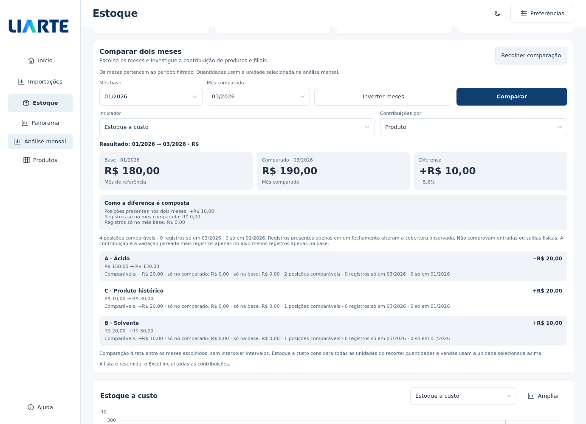

# Comparador mensal de estoque

Em **Estoque > Análise mensal**, abra **Comparar meses**, escolha **Mês base** e **Mês comparado** e pressione **Comparar**. Os meses podem não ser consecutivos; **Inverter meses** troca o formulário, e o novo sentido só é aplicado ao pressionar Comparar.

O painel mostra o valor em cada mês, a diferença e as contribuições por **Produto** ou **Filial**. O resultado identifica os meses efetivamente calculados, mesmo enquanto outro pedido está em andamento. Trocar o indicador ou a unidade não relê o PBIX.



[Exemplo de reconciliação de cobertura e agrupamento por filial](images/comparador-cobertura.png) · [Janela compacta no tema escuro](images/comparador-compacto.png). As capturas usam dados sintéticos e Qt em Linux; fontes e escala do monitor influenciam a aparência nativa no Windows.

## Indicadores e unidades

| Indicador | Abrangência |
| --- | --- |
| Estoque a custo | Custo dos fechamentos nas posições do recorte, em reais, considerando todas as unidades |
| Quantidade em estoque | Quantidade dos fechamentos somente na unidade selecionada na análise mensal |
| Vendas líquidas | Quantidade vendida nas filiais, somente na unidade selecionada; pode incluir devoluções |

O filtro geral **Unidade** restringe todo o recorte. O seletor **Unidade das quantidades**, dentro da análise mensal, muda a apresentação de quantidades e vendas. Quantidades de KG, L, UN ou outras unidades nunca são somadas entre si.

A comparação padrão usa os dois últimos fechamentos completos disponíveis no período. Na falta deles, tenta os meses completos de vendas e, por fim, os períodos disponíveis. Os meses escolhidos são preservados ao investigar um produto ou filial, enquanto continuarem no período filtrado.

## Como interpretar a diferença

Para estoque, a identidade comparável é **produto, filial, armazém e unidade**. O painel reconcilia:

```text
Diferença total observada
= diferença das posições presentes nos dois meses
+ valor dos registros só no mês comparado
− valor dos registros só no mês base
```

Os registros presentes em apenas um fechamento mudam a cobertura observada. Eles não comprovam, por si só, entrada, saída, transferência ou consumo físico. Uma posição ausente não recebe saldo zero; o valor desconhecido aparece como traço na tela e vazio no Excel.

As listas de Produto e Filial são duas perspectivas da mesma diferença e não devem ser somadas entre si. As linhas mostram a contribuição observada e sua parte comparável. Aumento e queda indicam direção, sem classificar automaticamente a situação como boa ou ruim.

Vendas são transações por produto, filial e unidade, sem atribuição a armazém. Num mês completo observado, a ausência de uma transação contribui zero conforme o contrato da base; isso não certifica a cobertura comercial de cada filial. As filiais com registros em cada mês são informadas. Com filtro de armazém, a comparação de vendas fica indisponível.

Fechamentos ausentes e meses parciais não geram variação de estoque. Para vendas, os dois meses precisam ser observados e completos. A disponibilidade de estoque e vendas é independente. Os totais conhecidos de cada lado continuam visíveis quando a diferença não pode ser calculada. Percentuais exigem base positiva; base nula ou negativa não gera percentual infinito.

Comparar janeiro e março usa diretamente esses fechamentos: não reconstrói fevereiro nem infere o que aconteceu entre os dois. As contribuições ajudam a localizar a diferença nos registros; suas causas operacionais precisam ser investigadas na origem.

## Investigar e exportar

Selecione uma linha para aplicar o filtro de produto ou filial e continuar na análise histórica. Produtos e filiais presentes apenas no histórico continuam investigáveis, mesmo sem saldo atual. Os filtros ABC, última venda e sinal do saldo selecionam uma coorte pela situação atual da base, como no restante da análise mensal.

A tela resume até oito linhas de cada lista. **Baixar Excel** inclui as abas **Comparação mensal** e **Contribuições**, com todas as linhas da comparação concluída, meses, filtros, unidades, regras e disponibilidade. Listas extensas são divididas em abas numeradas antes do limite do Excel. Valores que excedem a precisão numérica do Excel permanecem em texto decimal exato, identificado por comentário.

A escolha dos meses é aplicada em uma tarefa cancelável sobre o cache mensal. Página, detalhe e mês em análise são preservados. Um pedido mais recente substitui o anterior; cancelar restaura o par concluído. Em caso de falha, os resultados anteriores permanecem identificados, e é possível tentar novamente. A exportação aguarda uma comparação atual para evitar misturar pares de meses.

Esta melhoria integra a prévia **5.3.1-rc.2**. Use o Setup ou o ZIP dessa versão; veja as [notas da prévia](RELEASE_5.3.1-rc.2.md) e o [guia de instalação](INSTALACAO_531_RC2.md).
