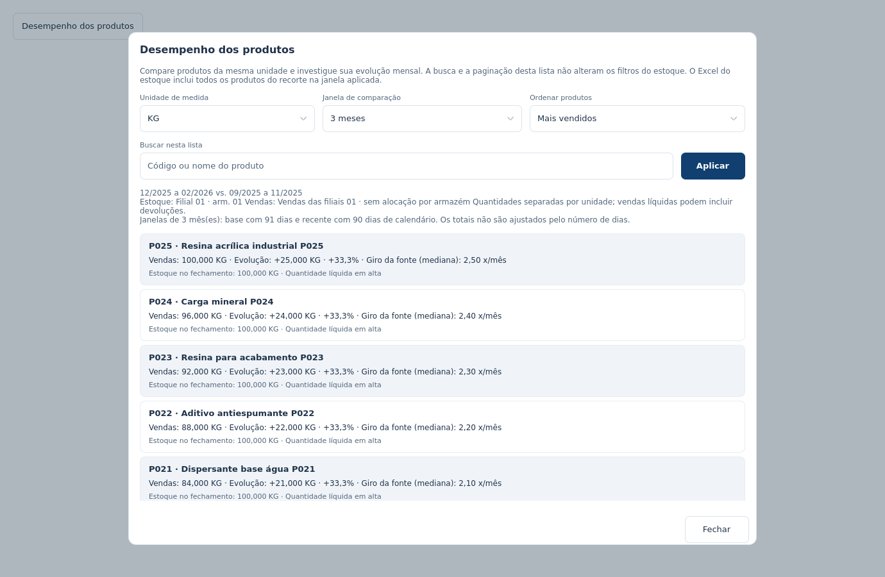

# Desempenho e giro dos produtos

Em **Estoque > Produtos**, abra **Desempenho dos produtos**. Escolha a unidade de medida, a janela de **1, 3 ou 6 meses**, o critério em **Ordenar por** e, se desejar, o código ou nome. Nos indicadores que permitem as duas direções, use **Maior primeiro** ou **Menor primeiro** para alternar. Pressione **Aplicar**: as escolhas são provisórias até essa confirmação. A busca e a paginação pertencem a essa lista e preservam os filtros gerais, o comparador mensal e a tabela de posições.

[Investigação mensal de um produto](images/desempenho-produto.png) · [Apresentação compacta](images/desempenho-compacto.png). As capturas usam dados sintéticos processados pelo cálculo e controller reais, com Qt em Linux. Fontes e escala do monitor influenciam a aparência nativa no Windows.

[Lista com ordenação de giro e direção](images/estoque-ordenacao-giro.png) · [Ordenação das posições de estoque](images/estoque-ordenacao-posicoes.png).

| Ordenação | Produtos incluídos |
| --- | --- |
| Mais vendidos | Quantidade líquida positiva, do maior para o menor valor na janela recente |
| Menor venda com saldo | Quantidade líquida não negativa e fechamento-alvo positivo, do menor para o maior valor |
| Maior queda nas vendas | Diferenças negativas entre janelas completas, sem janelas com saldo líquido negativo |
| Giro mensal da fonte (mediana) | Mediana dos giros válidos das posições com saldo positivo no fechamento-alvo; maior ou menor primeiro |
| Estoque a custo no fechamento | Valor a custo do fechamento-alvo; maior ou menor primeiro |
| Saldo no fechamento | Quantidade na unidade escolhida no fechamento-alvo; maior ou menor primeiro |
| Cobertura estimada | Dias estimados segundo as condições descritas abaixo; maior ou menor primeiro |
| Todos os produtos | Todos os produtos observados na unidade escolhida; útil para procurar devoluções, histórico insuficiente e itens sem fechamento |

Os três rankings de vendas mantêm suas próprias regras de inclusão e direção. Para giro, valor a custo, saldo, cobertura e produto, a direção pode ser invertida. **Todos os produtos** também permite alternar a ordem alfabética dos nomes. O critério aplicado e seu valor aparecem na lista; escolher outra opção ainda não aplicada não muda os resultados apresentados.

**Contexto e critérios** mostra ou recolhe o escopo e as definições detalhadas. Período, ordenação aplicada e avisos essenciais de meses parciais ou histórico insuficiente permanecem visíveis.

A ordenação usa toda a lista filtrada antes de mostrar a página. Valores ausentes ou inelegíveis ficam ao final nas duas direções; zero permanece um valor conhecido. Giro ou cobertura negativos não são classificados como indicadores baixos válidos. Valores negativos de saldo ou custo permanecem numéricos e rastreáveis. Ao aplicar outra ordenação, a lista volta à primeira página.

Quantidades de KG, L, UN e outras unidades não são somadas nem comparadas entre si. O filtro geral de unidade restringe o recorte; o seletor dentro da janela organiza a apresentação. A lista inclui produtos apenas históricos, mesmo sem saldo atual, e apresenta dez produtos por página.

## Períodos comparáveis

Cada janela usa meses consecutivos completos e é comparada à janela imediatamente anterior com o mesmo número de meses. Por exemplo, a janela de três meses encerrada em setembro compara **julho–setembro** com **abril–junho**. Outubro parcial permanece no gráfico e fica fora dessa comparação.

O último mês parcial pode ser excluído; meses ausentes ou sem observação não são substituídos por meses anteriores. Uma janela de seis meses exige doze meses completos no período geral. Se o período geral incluir um mês parcial, amplie seu início para obter doze completos. Sem história suficiente, os valores conhecidos continuam visíveis e a evolução fica indisponível.

As janelas têm o mesmo número de meses, mas podem ter números diferentes de dias de calendário, informados na análise. Vendas são quantidades líquidas e podem incluir devoluções. O percentual exige base positiva e nenhuma janela negativa. Quantidade zero na janela anterior não prova lançamento do produto ou ausência de vendas: saídas podem ter sido compensadas por devoluções.

## Investigar um produto

Selecione um produto para abrir sua investigação na mesma janela. Fechar a janela preserva a investigação concluída para reabrir ou exportar. **Voltar à lista** encerra essa investigação e preserva busca, ordenação e página. A ação separada **Filtrar este produto** aplica produto e unidade ao estoque geral.

A investigação apresenta vendas, evolução entre janelas, cobertura estimada e giro da fonte. O gráfico alterna **Vendas**, **Quantidade no fechamento** e **Giro da fonte**, sem combinar escalas diferentes. Use o cursor ou as setas para consultar cada mês. Meses parciais são identificados; lacunas permanecem sem valor.

**O que os dados mostram** reúne valores e períodos: vendas, fechamentos, picos mensais completos, concentração das quantidades líquidas positivas e diferenças entre posições comparáveis. Empates no pico são informados. Um pico isolado não comprova sazonalidade.

**Hipóteses a verificar** propõe investigações condicionais. Por exemplo, queda nas vendas e crescimento do saldo nas mesmas posições justificam conferir demanda, entradas e finalidade do item. Matérias-primas e itens de uso interno não devem ser classificados como encalhados apenas por apresentarem pouca venda.

## Giro, cobertura e tempo no estoque

O **giro da fonte** é o indicador mensal original de cada posição. A apresentação usa a mediana dos valores finitos não negativos das posições com quantidade positiva, informa o número de posições e não soma giros. Essa mediana não representa giro consolidado do produto.

A **cobertura estimada** divide o saldo do fechamento-alvo pelo ritmo líquido diário registrado na janela recente. Exige vendas positivas, posições sem saldo negativo e as mesmas filiais nos registros de estoque e vendas. Se os escopos divergirem, fica indisponível. Com filtro de armazém, vendas e cobertura ficam indisponíveis, pois a fonte registra vendas por filial.

Cobertura estima quantos dias o saldo atenderia se o ritmo se repetisse. **Não mede há quanto tempo as unidades estão no estoque.** A base não fornece idade dos lotes, entradas, consumo interno, pedidos não atendidos, preços de venda ou motivos das transações. Não é possível confirmar ruptura, excesso de compras, margem ou uma causa comercial apenas com esses registros.

As diferenças de estoque usam posições idênticas de produto, filial, armazém e unidade. Registros apenas em um dos fechamentos mudam a cobertura observada; não provam entrada ou saída física. Fechamento ausente permanece desconhecido. Filtros ABC, atividade e sinal do saldo selecionam a coorte atual e não reconstituem sua classificação histórica.

## Excel e processamento

**Baixar Excel** inclui **Desempenho dos produtos**, com todos os produtos e unidades do recorte na janela aplicada, independentemente da busca, ordenação ou página da lista. Quando existe investigação concluída, inclui também **Investigação do produto**, com os fatos, hipóteses e limites do produto selecionado. Sem abrir o painel, a exportação usa a janela padrão de três meses.

O arquivo registra períodos, filtros, data da base, unidades e definições. Valores desconhecidos ficam vazios. Listas extensas são divididas antes do limite do Excel; valores além de sua precisão numérica ficam em texto decimal exato, identificado por comentário.

A análise usa o cache mensal já carregado, em tarefas canceláveis fora da interface. Não relê o PBIX nem consulta a internet ao buscar, ordenar, paginar ou investigar. Trocar a base ou os filtros descarta resultados antigos antes de publicar a nova análise.

Esta melhoria pertence aos fontes em desenvolvimento e não atualiza automaticamente os instaladores publicados anteriormente.
