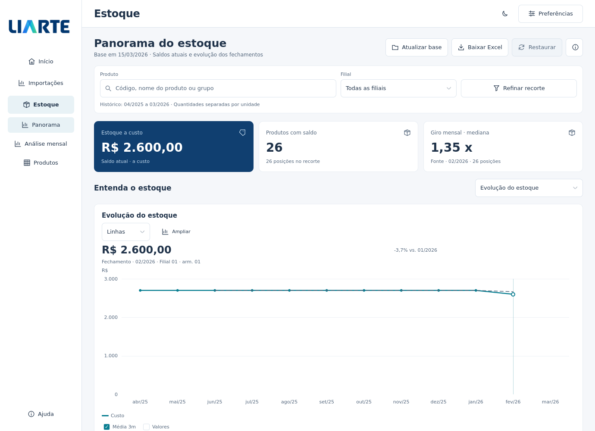

# Usar a interface por tarefa

O aplicativo organiza **Estoque** e **Importações** em vistas próprias. Escolher uma vista muda o conteúdo apresentado; não percorre uma única página com todos os painéis. Os dados carregados, os filtros e as seleções continuam na mesma sessão.

Nos fontes em desenvolvimento, **Produtos** passa a oferecer **Indicadores** e **Posições**. Os [recortes quantitativos](PRIORIDADES_PRODUTOS.md) e a retirada de hipóteses comerciais são melhorias posteriores à 5.3.1 publicada; os pacotes já distribuídos conservam a apresentação anterior dessa seção.

[Filtros aplicados em conjunto](images/interface-estoque-filtros.png) · [Análise mensal](images/interface-estoque-mensal.png) · [Mercado e origens](images/interface-mercado-origens.png) · [Resumo do mercado](images/interface-mercado-resumo.png) · [Registros em janela compacta](images/interface-registros-compacta.png). As capturas usam dados sintéticos e a interface Qt real em Linux; fontes e escala podem variar no Windows.

## Estoque

| Vista | Para que serve |
| --- | --- |
| Panorama | Conferir capital a custo, produtos com saldo e giro da fonte; alternar entre evolução do estoque e capital por produto |
| Análise mensal / Mês a mês | Consultar um fechamento, escolher o indicador do gráfico, comparar meses e explorar produtos do mês |
| Produtos | Consultar indicadores e critérios quantitativos, ordenar posições de estoque e investigar o desempenho de um produto |

O Panorama mostra três indicadores principais. Alertas e capital por última venda ficam acessíveis sob demanda. O giro apresentado como mediana da fonte não é uma soma de giros nem um giro consolidado da empresa.

A busca de produto e a filial permanecem próximas do recorte aplicado. Para escolher período, unidade, armazém, grupo, tipo, curva ABC, última venda e sinal do saldo, abra **Refinar recorte**. Faça as escolhas e pressione **Aplicar recorte**: o conjunto é validado antes de uma atualização da análise. **Cancelar** ou fechar o diálogo descarta as escolhas provisórias.

**Limpar opções**, dentro do diálogo, limpa os critérios adicionais, preservando período e busca de produto. O período seleciona vendas e fechamentos históricos; o saldo atual continua associado à data da base. Filtros ABC, última venda e sinal do saldo selecionam a coorte pela situação atual, sem reconstituir sua classificação histórica.

Na análise mensal, use o cursor ou as setas para consultar o gráfico. **Analisar este mês** aplica explicitamente o mês selecionado à investigação; mover o cursor sozinho não altera os filtros. **Explorar produtos deste mês** abre os rankings e as variações quando forem necessários. **Comparar meses** mantém suas próprias escolhas de mês-base e mês comparado.

Em Produtos, **Desempenho dos produtos** oferece rankings por unidade, janelas consecutivas de 1, 3 ou 6 meses e investigação individual. A seleção nessa lista não altera os filtros gerais. Use **Filtrar este produto** para aplicar essa mudança explicitamente. Veja as definições no [guia de desempenho](DESEMPENHO_PRODUTOS.md).

Na nova vista **Indicadores**, escolha o foco, a unidade e a janela e confirme em **Aplicar**. A lista apresenta cobertura inferior ao limite configurado, variação de vendas negativa, saldo positivo com venda líquida zero e valores a custo. Saldo e capital se referem ao fechamento identificado, enquanto **Posições** mantém os saldos atuais. Selecionar um produto abre valores e critérios sem alterar o recorte; **Histórico completo** mantém produto, unidade e janela, e **Ver posições** aplica produto e unidade explicitamente. As narrativas de hipóteses e sugestões foram substituídas por tabelas de indicadores e referências. Veja os [critérios e limites](PRIORIDADES_PRODUTOS.md).

Na lista **Posições de estoque**, use **Ordenar por** para escolher giro mensal da fonte, valor a custo, saldo, última venda, dias da fonte ou um dos campos de identificação. O botão ao lado indica a direção, como **Maior giro primeiro**, e permite invertê-la. Os cabeçalhos da tabela e esse controle compartilham a mesma ordenação. Trocar de vista preserva a escolha.

[Ver a ordenação das posições](images/estoque-ordenacao-posicoes.png) · [Ver a lista de produtos por giro](images/estoque-ordenacao-giro.png). As duas capturas usam dados sintéticos.

A ordenação considera todas as posições do recorte antes da paginação e volta à primeira página ao ser aplicada. Saldos são agrupados por unidade e ordenados dentro de cada grupo; para uma comparação direta, escolha a unidade em **Refinar recorte**. Valores ausentes ficam ao final nas duas direções. Giros e dias negativos da fonte continuam disponíveis para conferência, depois dos indicadores elegíveis. **Sem venda registrada** não é uma venda antiga nem a idade física do estoque.

O Excel inclui todas as posições do recorte na ordem aplicada, sem se limitar à página visível. A aba **Desempenho dos produtos** mantém sua abrangência própria: todos os produtos e unidades do recorte, independentemente da busca, ordenação ou página da lista de desempenho.

## Importações e mercado

| Vista | Para que serve |
| --- | --- |
| Resumo | Conferir os indicadores principais e alternar entre evolução mensal e participação das origens |
| Compras | Examinar referências por kg, concentração e comparação de origens no recorte compatível |
| Registros | Consultar os dados da tabela, buscar registros, escolher colunas e abrir o detalhe de uma linha |

Depois de concluir uma consulta, os campos do período podem ficar recolhidos. Use **Período** para escolher outro intervalo e consultar novamente. O período efetivamente carregado continua identificado; escolher meses no formulário não transforma os resultados anteriores em uma consulta nova. Erros, andamento e pausas solicitadas pelo Comex permanecem visíveis.

**Filtros** abre produto ou classificação, país e as demais dimensões disponíveis para a base selecionada. A seleção provisória de cada campo só é aplicada ao confirmar esse campo. Diferentemente do formulário de estoque, esses filtros mantêm a confirmação individual já utilizada nas Importações.

No gráfico de origens, clique ou use o teclado para selecionar um país e aplicar seu filtro. A participação considera todas as origens do recorte, mesmo quando a apresentação mostra apenas as seis principais. A busca de Registros restringe a tabela; não deve ser interpretada como mudança nos indicadores do mercado.

O menu de documentos mantém acesso a Excel, PDF e projeto Power BI conforme a disponibilidade da consulta. A exportação informa sua abrangência; uma página visível da tabela não limita automaticamente todo o arquivo exportado.

## Ler os gráficos e indicadores

- **Unidade e moeda:** estoque a custo é apresentado em reais. O mercado Comex usa valores nominais em dólares, com CIF na base geral e FOB na municipal. Quantidades de unidades diferentes não são somadas.
- **Preço e composição:** com vários códigos, uma média em US$/kg descreve o mix observado. Uma mudança pode decorrer da composição dos produtos. Comparar origens como referência de um produto exige o recorte compatível indicado na tela.
- **Tempo e cobertura:** dias estimados de cobertura, última venda, giro e idade física dos lotes são conceitos distintos. A base importada não permite afirmar a idade das unidades em estoque.
- **Lacunas e parciais:** ausência de fechamento não é saldo zero. Meses sem observação ou parciais não devem gerar uma comparação como se estivessem completos.
- **Escala:** quando a escala é ajustada para ampliar pequenas diferenças, o gráfico identifica que o eixo não começa em zero. O ajuste não altera os valores.
- **Acesso ao detalhe:** gráficos permitem leitura por cursor e teclado; indicadores oferecem sua descrição completa também por foco, quando disponível. Ampliar o gráfico e consultar seus valores preserva o mesmo recorte.

Navegar entre as vistas, alternar gráficos e consultar detalhes usa os dados já carregados. Uma nova consulta é necessária quando o usuário solicita outro período à fonte; trocar somente a apresentação não deve realizar chamadas de rede ou reler o PBIX.

## O que a análise dos PBIX acrescenta

Os dois arquivos enviados têm o mesmo conteúdo funcional. A [análise do BI](ANALISE_BI_E_EXPERIENCIA.md) registra suas tabelas, medidas, diferenças de recorte e fórmulas que precisam de revisão.

Receita, margem, entradas fiscais e carteira financeira são expansões possíveis porque existem campos correspondentes no BI. Esses módulos exigem contratos próprios antes de integrar o aplicativo. O custo já importado não é faturamento, e o cadastro examinado ainda não fornece o mapeamento produto–NCM necessário para cruzar diretamente empresa e mercado.

A organização por tarefas e as ordenações estão na estável **5.3.1**; veja as [notas](RELEASE_5.3.1.md) e o [guia de instalação](INSTALACAO_531.md). A nova vista Indicadores e a apresentação quantitativa estão nos fontes em desenvolvimento e dependem de uma entrega posterior.
