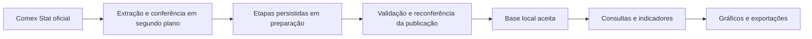

# Histórico local das importações

Nos fontes em desenvolvimento após a **5.3.1**, o histórico de importações dos produtos acompanhados pela empresa fica em uma base local persistente. O Comex Stat fornece a extração e a atualização; as consultas, filtros, gráficos e exportações utilizam a versão aceita dessa base. Os pacotes anteriores conservam o comportamento com que foram distribuídos.

## Escopo do histórico

O recorte acompanha os códigos do catálogo da empresa. A primeira carga percorre os intervalos anuais do mais antigo ao mais recente, dentro do contrato NCM disponível desde 1997 e até o último mês coberto pelas duas bases. Os dados gerais permanecem em NCM, UF, país e URF, com FOB, frete, seguro, CIF e peso. Os municipais permanecem em SH4, país e município fiscal, com FOB e peso. Os dois universos não são somados nem tratados como equivalentes.

Dados anteriores a 1997 usam outra classificação, NBM, e não são incorporados automaticamente. Mudanças históricas de códigos também exigem correlação oficial explícita; o histórico de um NCM atual não demonstra, sozinho, todo o histórico comercial do mesmo produto. Classificações e descrições recebidas são preservadas.

Uma resposta vazia validada registra cobertura conhecida. Um mês ainda não adquirido permanece indisponível: não vira zero. A identidade do catálogo faz parte da cobertura; ampliar o catálogo exige preencher novamente o histórico correspondente.

## Primeira carga e retomada

Entrar em Importações inicia a sincronização em segundo plano. Consultar também solicita uma verificação de atualização. A interface informa o progresso da carga inicial; antes de uma versão integral validada, não apresenta um histórico parcial como se estivesse completo.

Cada etapa aceita é gravada em preparação. Pausas, fechamento do aplicativo e falhas de rede não exigem repetir os dados já adquiridos da mesma execução compatível. Essa retomada inclui os metadados: se a segunda fonte recusar o pedido, o próximo trabalho continua pelo endpoint pendente, evitando consumir novamente a janela com o primeiro pedido.

Uma execução só substitui a versão aceita depois de concluir o plano, validar as duas bases e reconferir a publicação. Uma revisão incompatível detectada ao final impede a ativação. O cliente respeita integralmente `Retry-After`; uma pausa da extração não impede consultar os dados locais já aceitos.

## Atualização e revisões antigas

Os endpoints `dates/updated` informam a última publicação, mas não fornecem uma relação confiável de linhas ou meses alterados. Por isso, a sincronização precisa considerar inclusões, alterações e exclusões históricas. Acrescentar apenas o mês mais recente não atende ao modelo.

Quando muda a publicação, uma nova extração reconfere o histórico do catálogo antes de trocar a versão. Há também auditoria integral periódica para verificar revisões que conservem os mesmos metadados. Os padrões técnicos são:

| Política | Padrão | Significado |
| --- | --- | --- |
| Verificação de publicação | 300 s | Agrupa pedidos próximos; consultas locais não aguardam essa verificação |
| Auditoria integral | 86.400 s | Reextração periódica do histórico quando o aplicativo está em uso e a origem permite |
| Validade do checkpoint de metadados | 86.400 s | Limita o reaproveitamento de uma resposta parcial durante pausas |

São parâmetros técnicos configuráveis no sincronizador, não garantias de disponibilidade nem de detecção instantânea. A API não oferece uma transação única entre os pedidos: horários de aquisição e publicação observada acompanham a base. O hash identifica a extração local; não é uma assinatura oficial de toda a base nacional.

## Consultas durante falhas

Com uma base aceita, o aplicativo continua consultando sem internet e durante HTTP 429 ou indisponibilidade do Comex. O estado da atualização é separado do resultado da consulta. A data da base, a cobertura e a última verificação permitem distinguir dados disponíveis de uma atualização ainda não concluída.

A consulta lê uma versão consistente e somente o intervalo selecionado; não carrega décadas inteiras por padrão. Filtros e indicadores usam o mesmo contrato analítico existente. A publicação de uma nova versão invalida os resultados afetados, preservando seleção e filtros até o novo resultado estar pronto. A exportação conserva o snapshot com que foi solicitada, mesmo se outra atualização terminar durante sua preparação.

## Armazenamento e fontes

O histórico usa `historico_comex.sqlite3` no diretório de dados do perfil, em disco local. É separado da futura conexão **SQL Server do Estoque**. Não exige instalar ou administrar um servidor SQL para consultar Importações.

As métricas preservam precisão decimal e inteiros arbitrários, sem agregação em ponto flutuante. A cobertura, as revisões e o manifesto ativo são transacionais. Uma trava de escritor impede extrações duplicadas para o mesmo arquivo; consultas não aguardam o trabalho de rede.

O primeiro adaptador utiliza a API já integrada. O leitor legado de CSVs oficiais exige baixar arquivos anuais nacionais e homologar seus layouts e controles reais; não é ativado silenciosamente como fonte alternativa. A base local não acompanha o repositório Git nem o pacote de fontes. A duração e o tamanho da carga inicial dependem do catálogo, das respostas e dos limites reais da origem.

## Conferência da implementação

A validação deve cobrir reinício offline, leitura durante atualização e pausa, ausência de cobertura, resposta vazia, alterações e exclusões retroativas, catálogo ampliado, união SH4, precisão acima de 64 bits, cancelamento antes do commit e dois sincronizadores concorrentes. Testes e capturas usam dados sintéticos; a homologação da carga completa e da rede do usuário é uma etapa distinta.

As verificações incluem extração retomada com limites globais de 180 e 900 segundos, sem repetir endpoints de metadados já aceitos; exportação fixada na revisão apresentada; e recuperação de checkpoints opcionais inválidos. A abertura de um leitor não requer a trava de gravação de uma extração já em andamento.

| Estado sintético | Captura da interface Qt |
| --- | --- |
| Consulta local com atualização em pausa | [Janela ampla](images/comex-historico-local-sintetico.png) |
| Consulta disponível durante atualização | [Janela compacta e foco de teclado](images/comex-historico-compacto-sintetico.png) |
| Antes da primeira carga integral | [Carga inicial](images/comex-historico-primeira-carga-sintetica.png) |

## Conferir o pacote de teste

1. Extraia o ZIP portátil completo em uma pasta nova e abra `LIARTE_Desktop.exe`.
2. Entre em **Importações** e acompanhe a carga inicial. Pode fechar o aplicativo e continuar depois; as etapas aceitas ficam gravadas no perfil.
3. Após a conclusão, consulte um período, altere os meses e compare os resultados. A referência da base permanece visível enquanto a atualização trabalha.
4. Reabra sem internet e consulte um período coberto. A eventual falha de atualização deve aparecer separadamente, preservando a consulta local.

Os autotestes não efetuam a carga real de décadas. O primeiro uso depende do acesso à origem oficial, dos limites da API e do espaço disponível no perfil. O ZIP de código-fonte não substitui o pacote portátil compilado.
