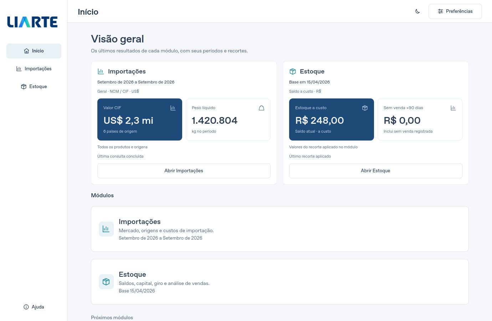
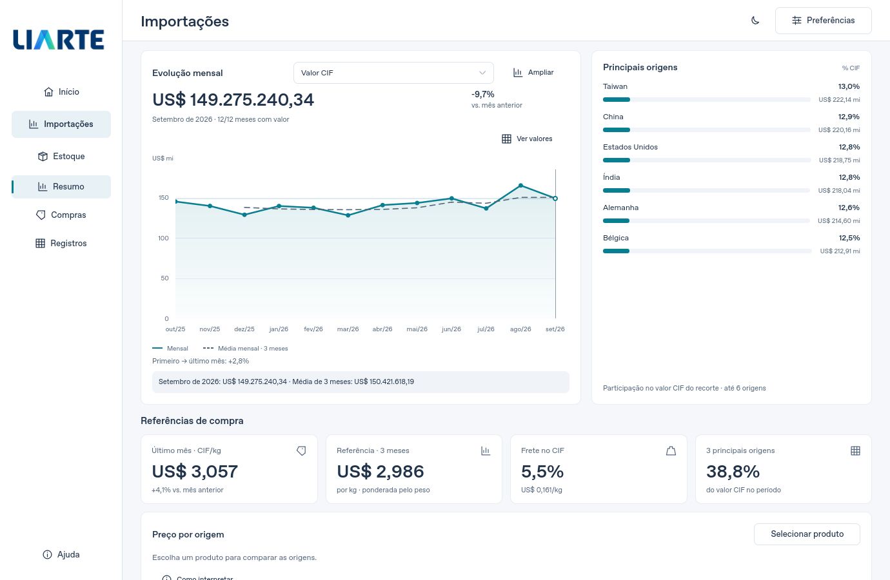
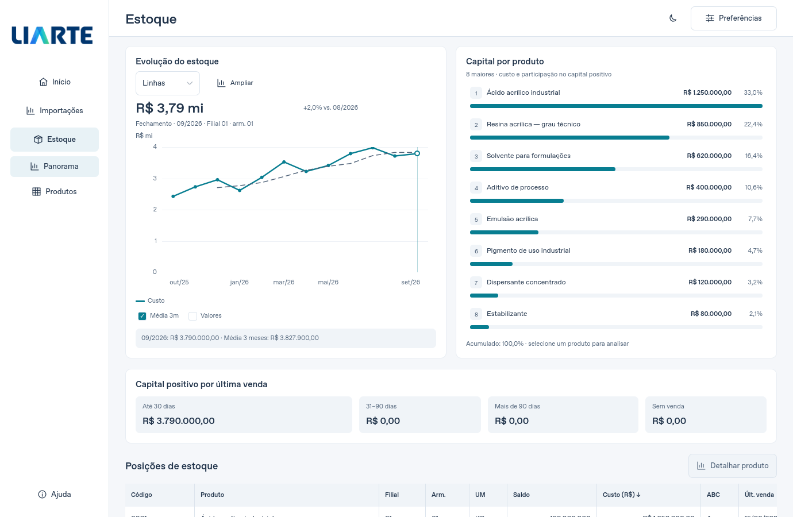
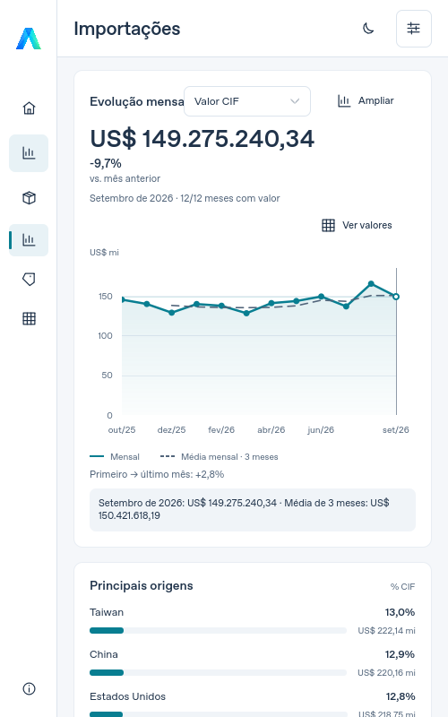
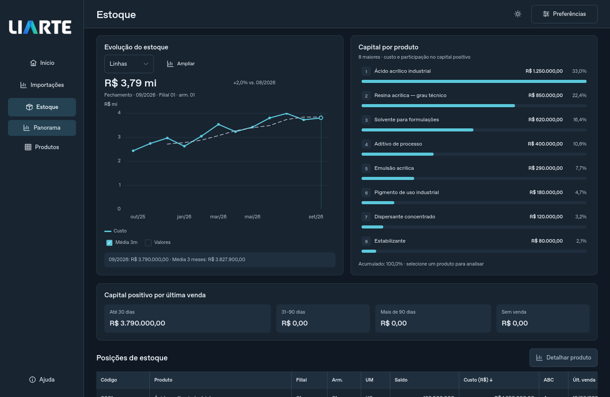

# Prévia 5.3.0-rc.1 — interface e gráficos

Esta revisão melhora a apresentação de Importações e Estoque. A página Início
resume os resultados já carregados e identifica o período, o recorte, a base
e a moeda de cada módulo. Os atalhos abrem o módulo preservando a consulta.

Os painéis dos gráficos usam a largura disponível e a altura do conteúdo,
com títulos alinhados, valores de referência destacados e textos que podem
quebrar linha. Os rótulos mensais reduzem a densidade em janelas pequenas,
mantendo o primeiro e o último mês acessíveis. A margem dos eixos considera
a largura dos números, incluindo sinais negativos e valores grandes.

**Ampliar** abre o gráfico com os mesmos pontos, unidade, escala e opções
de apresentação. A leitura por cursor e teclado continua disponível. O
gráfico de origens apresenta valores monetários e participação; o ranking
de capital reorganiza nomes, valores e percentuais conforme o espaço.

O resumo, a troca de indicador e a ampliação usam os dados já carregados.
Não iniciam consultas adicionais. Os cálculos financeiros, a cobertura e o
giro da fonte, os denominadores, as unidades e a separação NCM/CIF de
SH4/FOB foram preservados. Meses ausentes continuam sem valor; a média móvel
continua exigindo os meses correspondentes. A animação usa revelação visual,
sem repintar a curva a cada frame ou a cada movimento do cursor.

As regressões verificam os eixos, lacunas, teclado, movimento reduzido,
cartões iniciais, preservação de filtros, abertura e redimensionamento dos
gráficos e ausência de novas chamadas de rede nesses controles.

As capturas desta revisão usam exclusivamente dados sintéticos. Elas servem
para avaliar o layout e não representam resultados reais da empresa ou da
API. A versão estável 5.2.0 permanece disponível no GitHub Releases.

## Validação

No Linux, `python verificar.py --headless --volume` passou com **626 testes
em 105,199 s**, sem falhas ou testes ignorados. O ensaio de 100 mil registros
fez a primeira consulta em 1,104 s e processou 68 eventos Qt. Os testes
direcionados verificaram também fontes ampliadas e a posição dos rótulos
nas margens dinâmicas dos eixos. A revisão independente e as capturas não
registraram avisos QML.

As evidências, os hashes das imagens e o escopo estão em
[EVIDENCIAS_INTERFACE_530_RC1.json](EVIDENCIAS_INTERFACE_530_RC1.json).
A [execução Windows 40000381574](https://github.com/Souzlx/Liarte_Interf/actions/runs/40000381574) passou no
commit `7058bc74dbf3493d118e211afafd3ab817bab327`. Cada job executou 626 testes, com 625 aprovados,
um caso exclusivo de POSIX ignorado e nenhuma falha. Os quatro executáveis
5.3.0-rc.1 passaram no autoteste nativo com Qt 6.10.3, sem avisos QML, e
recursos de Excel, PDF e Power BI aprovados.

| Python | Aprovados | Ignorados | Tempo da suíte | Prévia portátil |
|---|---:|---:|---:|---|
| 3.11 | 625 | 1 | 236,329 s | [ZIP](https://github.com/Souzlx/Liarte_Interf/actions/runs/40000381574/artifacts/12521558617) |
| 3.12 | 625 | 1 | 254,152 s | [ZIP](https://github.com/Souzlx/Liarte_Interf/actions/runs/40000381574/artifacts/12522111554) |
| 3.13 | 625 | 1 | 234,302 s | [ZIP](https://github.com/Souzlx/Liarte_Interf/actions/runs/40000381574/artifacts/12521628028) |
| 3.14 | 625 | 1 | 233,294 s | [ZIP](https://github.com/Souzlx/Liarte_Interf/actions/runs/40000381574/artifacts/12522326445) |

Para baixar, entre no GitHub e use o ZIP desejado. Se necessário, abra a
execução, selecione **Summary** e baixe em **Artifacts**. Extraia o ZIP
inteiro em uma pasta nova e abra LIARTE_Desktop.exe. Confira **5.3.0-rc.1**
em Ajuda. O pacote inclui Python e dependências.

As métricas e metadados completos estão em
[VALIDACAO_WINDOWS_530_RC1.json](VALIDACAO_WINDOWS_530_RC1.json). Os resultados
nativos foram conferidos nos logs; o ZIP do Actions não foi reinspecionado
localmente. O teste POSIX ignorado não certifica o bloqueio por processos
Windows; DPI/GPU específicos continuam dependentes do computador de destino.

Na primeira execução Windows, dois testes revelaram o deslocamento do rótulo
do último mês e o corte de um valor do ranking com fontes mais largas. As
margens passaram a reservar a meia largura do rótulo em ambos os extremos;
o ranking mede a coluna numérica pelo texto integral e reorganiza percentual
e valor no modo compacto. Regressões com fontes largas reproduzem os casos.
A nova execução validou as correções nas quatro versões do Python.

O job de publicação de release permaneceu desativado para esta prévia;
a versão estável 5.2.0 e seu download permanecem disponíveis.

## Capturas com dados sintéticos

Resumo inicial, com resultados de exemplo dos dois módulos:

Importações, com série mensal e participação das origens de exemplo:

Estoque, com fechamentos e oito produtos de exemplo:

Importações em uma janela de 500 pixels, usando dados sintéticos:

Estoque em tema escuro, usando dados sintéticos:

