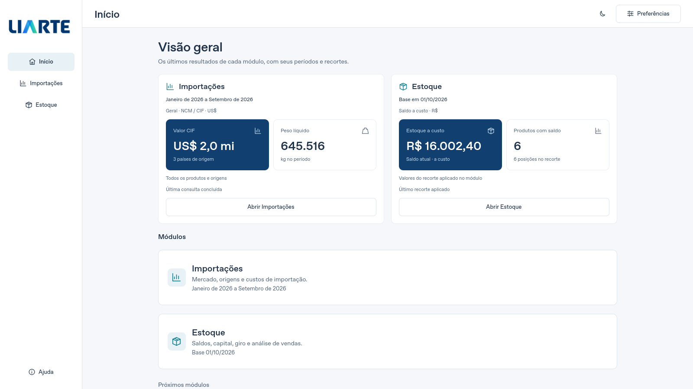
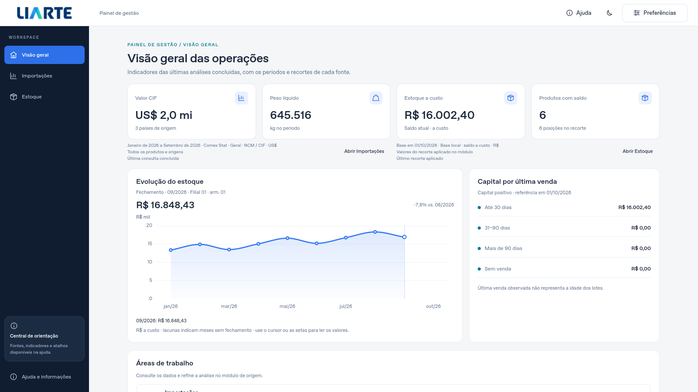
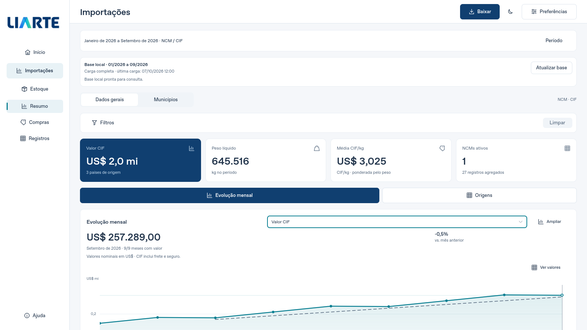
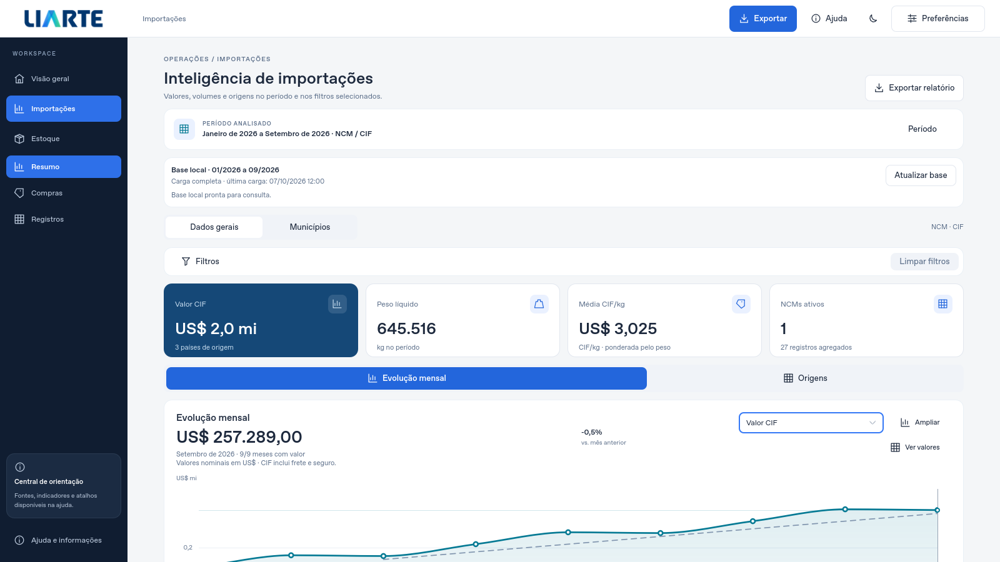
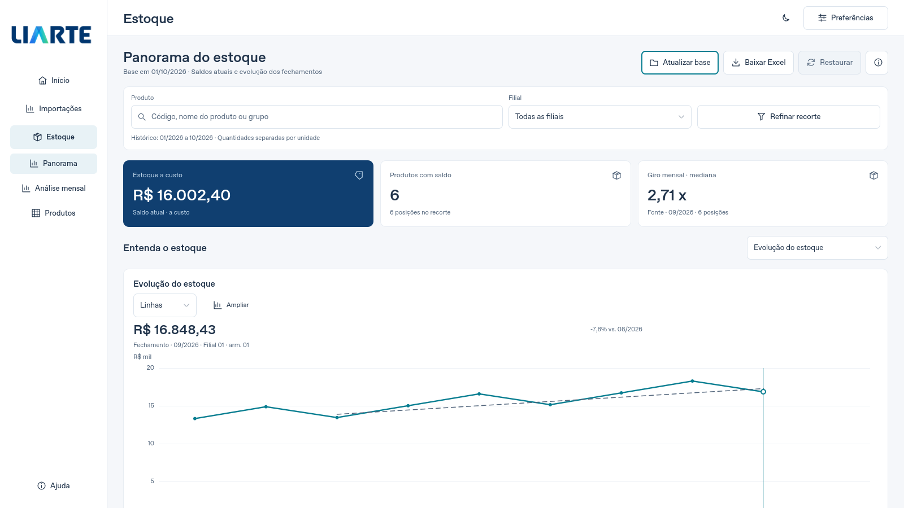
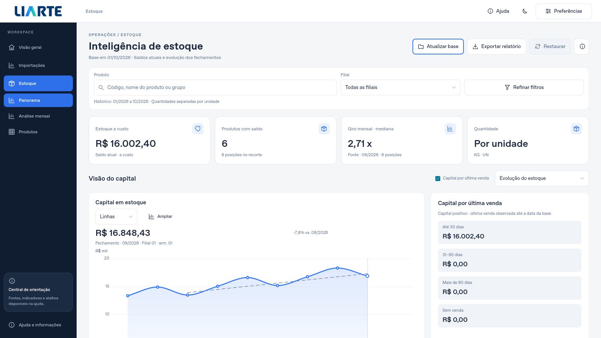
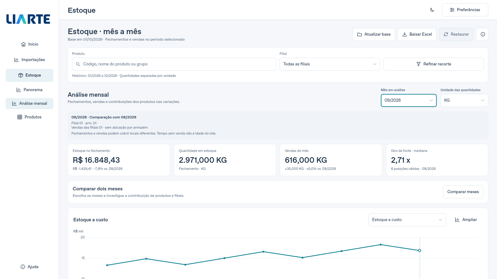
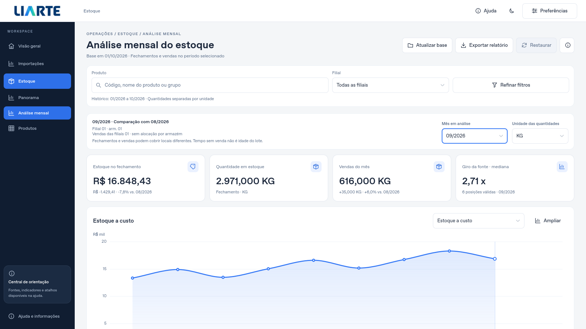

# Redesign visual V6

V6 identifica a proposta visual, sem alterar a versão do aplicativo. A implementação parte dos fontes com histórico local do Comex, posteriores à 5.3.1 publicada. A distribuição estável e suas tags permanecem vinculadas à entrega original.

## Referências e levantamento

O pacote recebido foi examinado antes das alterações: `PROMPT_PRINCIPAL_CODEX.md` integral, os dois PNGs `ORIGINAL_Figma_AI_*`, os quatro PNGs `V2_*`, o logotipo e o painel de referências. O HTML serve apenas como referência estética e não integra o aplicativo.

Os originais orientam barra superior, sidebar, tipografia, cores, margens, cartões e gráficos. As adaptações V2 orientam a disposição dos recursos reais. Os contratos dos fontes e dos testes prevalecem sobre os dados ilustrativos e os recursos fictícios das imagens.

| Área | Composição visual | Contrato preservado |
| --- | --- | --- |
| Janela | Barra superior, identidade oficial e navegação navy | Módulos persistentes, atalhos, foco, preferências e proteção de fechamento |
| Visão geral | Indicadores dos resultados aceitos, histórico e atalhos | Sem consulta automática, novos cálculos de negócio ou indicadores simulados |
| Importações | Cabeçalho, período, bases, filtros, indicadores e gráfico amplo | NCM/CIF e SH4/FOB separados; histórico local, pausas e atualização independente |
| Estoque | Recorte, indicadores, evolução e ferramentas por tarefa | PBIX/`.liarte`, precisão, unidades, buscas, posições, ordenações e detalhes |
| Análise mensal | Composição coerente com Estoque | Vista dentro de Estoque, lacunas, meses parciais e abrangência das vendas preservados |
| Componentes | Tokens, cartões, controles e preenchimento sutil nos gráficos | Temas claro/escuro, redução de movimento, teclado e valores originais |

Não há migração de arquitetura, navegador embarcado, dependência nova, fonte baixada de terceiros, usuário fictício ou novos módulos financeiros. Gráficos reutilizam as apresentações existentes. Uma linha entre observações não cria observações intermediárias nem elimina lacunas.

O azul da navegação foi ajustado de `#3478F6` para `#2E70E9`, muito próximo da referência, para manter contraste do texto branco. O azul original permanece nos gráficos de Estoque. O teal dos textos também foi conferido contra o fundo claro. As curvas usam interpolação monotônica entre observações, com marcadores e leitura exata; não atravessam meses ausentes. O preenchimento de Estoque é desativado quando o eixo contém valores negativos.

Na Visão geral, os indicadores permanecem associados aos resultados e recortes aceitos de cada módulo. Estoque mostra capital por última venda observada em vez de simular uma classificação de saúde. No Panorama, o quarto cartão informa quantidade por unidade, respeitando a indisponibilidade de um total entre unidades diferentes. A análise mensal continua dentro de Estoque.

## Arquivos de implementação

Todos os caminhos abaixo são relativos à raiz do repositório.

| Arquivo | Alteração |
| --- | --- |
| `src/liarte_desktop/qml/Main.qml` | Barra superior e navegação navy, com rotas, atalhos, diálogos e ações originais |
| `src/liarte_desktop/qml/HomePage.qml` | Composição dos indicadores, série histórica, distribuição por última venda, atalhos e foco após o layout |
| `src/liarte_desktop/qml/ImportsWorkspace.qml` | Cabeçalho, exportação contextual, abas e seletor de visualização |
| `src/liarte_desktop/qml/InventoryWorkspace.qml` | Títulos contextuais, ações e margens do Estoque |
| `src/liarte_desktop/qml/components/Theme.qml` | Tokens compartilhados, contraste e equivalentes escuros |
| `src/liarte_desktop/qml/components/ActionButton.qml` | Estados e raios dos botões |
| `src/liarte_desktop/qml/components/AppCombo.qml` | Aparência dos seletores |
| `src/liarte_desktop/qml/components/FilterChip.qml` | Aparência dos filtros aplicados |
| `src/liarte_desktop/qml/components/MetricCard.qml` | Cartão reutilizável, ícone vetorial e altura conforme o conteúdo |
| `src/liarte_desktop/qml/components/StockToggle.qml` | Checkmark vetorial e estados do controle |
| `src/liarte_desktop/qml/components/LinePlot.qml` | Curvas, marcadores e linha de referência de Importações |
| `src/liarte_desktop/qml/components/StockPlot.qml` | Curvas, preenchimento, marcadores e cores parametrizadas |
| `src/liarte_desktop/qml/components/ImportQueryPanel.qml` | Período aplicado, formulário e rótulos acessíveis |
| `src/liarte_desktop/qml/components/ImportFilters.qml` | Barra de filtros e limpeza |
| `src/liarte_desktop/qml/components/ImportTrendPanel.qml` | Hierarquia do gráfico e ações que se reorganizam com fontes amplas |
| `src/liarte_desktop/qml/components/StockOverview.qml` | Quatro indicadores e gráfico com painel lateral recolhível |
| `src/liarte_desktop/qml/components/StockMonthly.qml` | Período, unidade, abrangência, cartões e prioridade visual do gráfico |
| `tests/test_redesign_visual.py` | Geometria da janela e menus, período provisório e assinatura nativa de exportação |
| `tests/test_home_indicators.py` | Dados aceitos, lacunas e valores acessíveis pelo teclado na Home |
| `tests/test_interface.py` | Contraste também do token teal nos dois temas |
| `verificar.py` | Registro da nova classe, sem retirar os testes existentes |
| `tools/capture_redesign.py` | Captura Qt reproduzível, fixtures isoladas, ausência de rede e hashes da árvore QML |

Este guia, o índice de documentação e o guia da interface registram a nova composição. As evidências e imagens identificam sua própria execução; não substituem as evidências históricas da release 5.3.1.

## Verificação reproduzível

Use um ambiente Qt com as dependências do projeto e perfil descartável. A suíte comum usa dados sintéticos, sem a rede ou os arquivos empresariais.

```sh
python verificar.py --headless --volume --isolate
python tools/check_repository.py
python -m unittest discover -s tests/repository -v
```

Os módulos de verificação são isolados em processos novos para evitar compartilhar o estado global Qt entre testes. Todas as classes registradas continuam obrigatórias. A conferência visual complementa os testes de cálculos, filtros, exportações, cancelamento e navegação; não os substitui.

Capturas com resultados preenchidos devem usar somente fixtures sintéticas identificadas. Uma captura do estado vazio também deve confirmar que a interface não preenche indicadores antes de receber dados. As capturas são da aplicação Qt renderizada, não da maquete HTML.

```sh
python tools/capture_redesign.py --output /tmp/liarte-v6-sintetico --width 1600 --height 900 --keyboard
python tools/capture_redesign.py --output /tmp/liarte-v6-vazio --width 500 --height 400 --empty --keyboard
```

O utilitário precisa do checkout de desenvolvimento com `tests/`; não é um novo modo da aplicação distribuída. Ele usa um perfil temporário e impede chamadas de rede. Os hashes QML antes e depois da captura precisam coincidir. Para comparar com outro checkout, informe `--source-root`.

## Capturas comparáveis

Qt Quick real, Linux offscreen/software, 1600×900. Os números preenchidos vêm exclusivamente de fixtures sintéticas de teste, iguais antes e depois. A imagem inicial sem dados confirma o estado vazio da aplicação.

| Vista | Antes | V6 |
| --- | --- | --- |
| Visão geral |  |  |
| Importações |  |  |
| Estoque |  |  |
| Análise mensal |  |  |

Gráficos após rolar o conteúdo: [Importações](images/redesign-v6/v6-imports-general-chart-sintetico.png), [Origens](images/redesign-v6/v6-imports-origins-sintetico.png), [Estoque](images/redesign-v6/v6-stock-chart-sintetico.png) e [Mensal](images/redesign-v6/v6-monthly-chart-sintetico.png). A rolagem preserva os dados e libera a área do gráfico; ampliar continua disponível.

[Mensal compacta no tema escuro](images/redesign-v6/v6-mensal-compacto-escuro-sintetico.png) · [Home sem resultados](images/redesign-v6/v6-home-vazia.png).

A matriz visual inclui 1366×768, 1600×900, 1920×1080, 500×400, temas claro/escuro e fatores Qt de 1,25 e 1,5 no Linux. Esses fatores simulam densidade Qt e não homologam o escalonamento do Windows. Os 72 PNGs finais e os 14 anteriores têm hashes e estados de teclado/geometria no pacote de evidências.

## Resultado desta execução

Em Python 3.12.14 e Qt 6.10.3 no Linux, a execução completa isolada aprovou **1.379 testes em 87 módulos**, sem falhas, erros ou skips. Os 18 testes de organização do repositório passaram; Ruff nos arquivos Python alterados, links e política de arquivos também passaram. Os [resultados e hashes](EVIDENCIAS_REDESIGN_V6.json) vinculam a validação à árvore QML e aos fontes.

O autoteste de inicialização dos fontes aprovou os dois temas, recursos de Excel/PDF/Power BI, diálogo de salvamento, backups e consulta SQLite offline sintética. A lista de avisos QML ficou vazia. Esse autoteste indica `frozen: false`; não constitui teste de um novo executável Windows.

Na primeira execução completa, dois testes existentes detectaram foco fora da tela na Home vazia compacta e texto de período cortado com fonte ampliada. As correções mantiveram os testes originais e foram seguidas pela nova execução integral aprovada. Os testes novos também verificam o bloqueio de exportação com período provisório, os menus dentro da janela e a assinatura nativa original `openExportMenu()`.

## Limites de homologação

Uma validação Linux com Qt offscreen comprova a composição dos fontes nesse ambiente. A aparência das fontes, o escalonamento e a interação no monitor Windows exigem conferência própria. A geração e a homologação de um portátil ou Setup são etapas separadas; este documento não declara um executável novo como validado.

A carga histórica real do Comex e a futura conexão SQL Server de Estoque conservam os limites descritos nos respectivos guias. O redesign não fornece uma conexão SQL nem muda a aquisição de dados.
