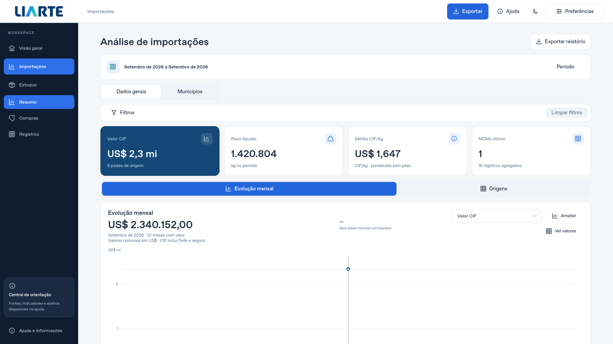
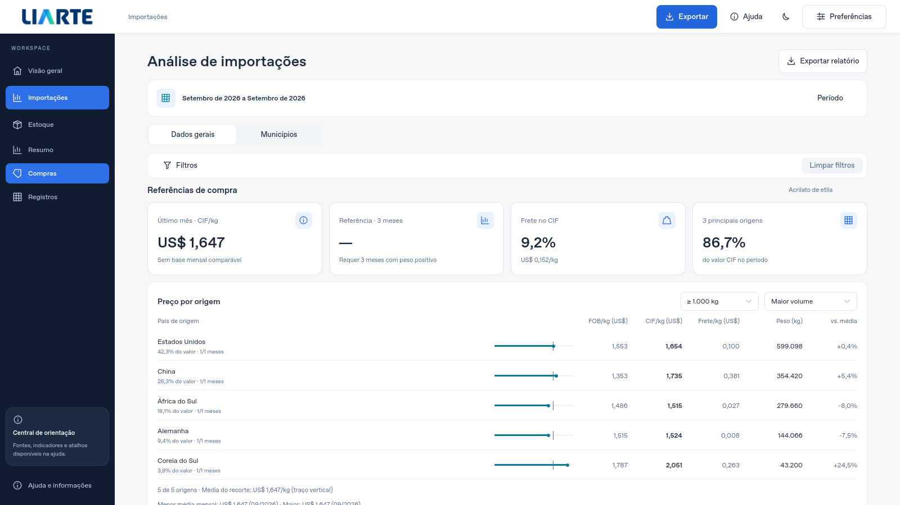

# Refino da análise de importações

A tela prioriza o período, os indicadores, os filtros e os gráficos. O título passa a ser **Análise de importações**. O resumo recolhido apresenta apenas as datas; nomes técnicos da classificação e da valoração ficam nos contextos correspondentes, sem duplicar o período.

Durante uma consulta com progresso mensurável, o cabeçalho mostra a barra e a porcentagem. Operações sem estimativa não inventam um percentual. Ordenação, paginação e filtros rápidos preservam a posição da tela e o indicador discreto já existente na tabela.

## Atualização automática

O Comex continua sendo verificado automaticamente em segundo plano, com intervalo e coalescimento das tarefas. Consultas usam os dados aceitos sem esperar por uma nova aquisição. A verificação sem novidade não baixa dados novamente; auditorias periódicas mantêm a detecção de correções retroativas. Quando uma auditoria recebe os mesmos dados e referências válidas, a geração, os recibos e o backup existentes são preservados. Conteúdo ou referências danificados continuam sendo reparados.

O controle manual fica em **Preferências → Atualizações de importações → Verificar atualizações**. Cobertura, referências técnicas, pausa e backup aparecem nessa área separada. O diálogo preserva teclado, cancelamento e bloqueio dos atalhos do dashboard.

## Cartões

Os cartões usam altura natural, margem interna consistente e alinhamento vertical do conteúdo. Título, ícone, valor e detalhe permanecem dentro do quadro. Valores monetários, unidades, denominadores, fórmulas, filtros e exportações foram preservados.

## Validação e capturas

Fontes `6b4c4d7`: **1.411 testes em 88 módulos**, sem falhas, erros ou skips no Linux, em 270,059 s. O volume usou 100 mil registros em 1,424 s, com 87 eventos Qt. Os 18 testes de organização também passaram. O [CI Linux](https://github.com/Souzlx/Liarte_Interf/actions/runs/43219471810) e os quatro jobs da [matriz Windows](https://github.com/Souzlx/Liarte_Interf/actions/runs/43219478235) foram aprovados. Cada job Windows exige pré-validação Qt, suíte completa, compilação e autoteste do executável antes do upload.

A revisão adicional reproduziu e corrigiu a preservação indevida de recibos de data inválidos durante uma auditoria idêntica. As duas regressões novas cobrem nove subcasos e a recuperação da consulta após a auditoria. Os [resultados, hashes e limites](EVIDENCIAS_REFINO_IMPORTACOES.json) identificam exatamente os fontes e as capturas.

Os logs completos confirmam, em cada uma das quatro versões Windows, **177 testes de pré-validação aprovados** e **1.411 testes na suíte completa: 1.410 aprovados e um skip POSIX**, sem falhas ou erros. Os quatro executáveis passaram no autoteste compilado em Windows, incluindo histórico offline, documentos, backups, temas claro e escuro, ícone e diálogo, sem avisos QML. O skip do subprocesso POSIX não substitui a conferência nativa de locks após crash no Windows.

As capturas abaixo são da aplicação Qt real, com dados sintéticos de teste, sem consultas à API pública ou dados da empresa.





[Carregamento simulado](images/refino-importacoes/importacoes-carregamento-sintetico.png) · [Cartões em 500×400, tema escuro](images/refino-importacoes/importacoes-compacta-escura-sintetico.png) · [Atualização nas Preferências](images/refino-importacoes/importacoes-preferencias-sintetico.png).

## Pacote de teste

[Baixar o portátil Windows Python 3.12](https://github.com/Souzlx/Liarte_Interf/actions/runs/43219478235/artifacts/13945053893). Se o link não abrir, entre na conta com acesso ao repositório e procure **Artifacts** na [execução](https://github.com/Souzlx/Liarte_Interf/actions/runs/43219478235). Artefatos do Actions têm retenção limitada.

O ZIP Python 3.12 foi baixado e verificado independentemente neste ambiente: **94.457.214 bytes**, CRC válido em todos os membros, caminhos sem duplicação e SHA-256 coincidente em cada um dos **1.410 arquivos** listados no manifesto. O digest do ZIP também corresponde ao informado pelo GitHub:

```text
04181abcbf2efb6a7691702a67886dd9e35f421e237f17ff0c1ecbed18ff5123
```

O `AUTOTESTE.json` incluído no pacote confirma execução compilada em `win32`, histórico offline e ausência de avisos QML. Os arquivos QML empacotados contêm o título, o período sucinto, o progresso percentual e a atualização separada nas Preferências. O executável foi testado no CI Windows; a inspeção local do ZIP no Linux não equivale a executar o binário Windows. Somente o ZIP Python 3.12 foi baixado e verificado independentemente aqui.

A publicação da regra de rede `*.blob.core.windows.net` liberou o acesso ao armazenamento desta execução. Os quatro logs Windows e o log Linux também foram recuperados e conferidos; não há pendência de acesso para esta verificação.

Entrega no [PR #16](https://github.com/Souzlx/Liarte_Interf/pull/16), com a [relação completa de arquivos alterados](https://github.com/Souzlx/Liarte_Interf/pull/16/files).

Extraia a pasta inteira e abra `LIARTE_Desktop.exe`; o runtime Python está incluído. A consulta, os filtros, as exportações e a retomada continuam usando o mesmo perfil. A conferência visual manual no Windows permanece separada dos testes automatizados. Esta entrega não publica uma nova release nem altera a versão instalada anteriormente.
